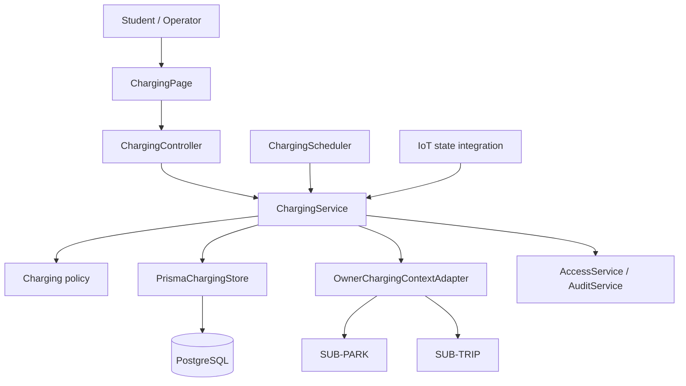

# SUB-CHG – Quản lý sạc và lịch sạc

## 1. Tổng quan phân hệ

SUB-CHG quản lý nhu cầu sạc và quá trình phân bổ cổng sạc cho phương tiện điện tại các Mobility Hub trong mạng lưới SEMH. Do số lượng cổng sạc và công suất điện tại mỗi Hub có giới hạn, hệ thống cần sắp xếp các yêu cầu theo mức độ ưu tiên, đồng thời bảo đảm lịch sạc không xung đột và phù hợp với khả năng phục vụ thực tế.

Phân hệ hỗ trợ sinh viên đăng ký sạc cho xe cá nhân, xem lịch dự kiến và theo dõi tiến độ. Nhân viên vận hành có thể tạo nhu cầu sạc cho xe dùng chung, giám sát các yêu cầu trong phạm vi được cấp quyền và điều chỉnh lịch chưa bắt đầu khi cần thiết. Trạng thái sạc được cập nhật dựa trên sự kiện từ nguồn dữ liệu IoT hoặc bộ giả lập, thay vì chỉ dựa vào thời gian dự kiến.

SUB-CHG giải quyết trực tiếp vấn đề `PB-04` (năng lực sạc có giới hạn), đáp ứng nhu cầu `SN-STU-05`, `SN-OPR-05` và các user story `US-CHG-01`, `US-CHG-02` trong báo cáo phân tích và thiết kế hệ thống.

## 2. Phạm vi và tác nhân

### 2.1. Tác nhân

| Tác nhân | Vai trò trong SUB-CHG |
| --- | --- |
| Sinh viên (`ACT-STU` / `STU`) | Đăng ký sạc và theo dõi các yêu cầu của chính mình đối với xe cá nhân thuộc quyền sở hữu. |
| Nhân viên vận hành (`ACT-OPR` / `OPR`) | Tạo nhu cầu sạc cho xe dùng chung, theo dõi lịch trong phạm vi Hub được cấp quyền, điều chỉnh thứ tự hoặc cổng sạc. |
| IoT & State Data Gateway (`ACT-DAT` / `EXT-STATE`) | Cung cấp dữ liệu mức pin, trạng thái cổng và sự kiện bắt đầu, tiến độ, hoàn tất, giải phóng hoặc lỗi sạc. |

Nhân viên kỹ thuật phối hợp xử lý sự cố thông qua SUB-OPS. Quyền quản trị tài khoản và phân quyền thuộc GEN; quyền quản trị không mặc nhiên cho phép điều chỉnh lịch sạc.

### 2.2. Phạm vi nghiệp vụ

SUB-CHG chịu trách nhiệm quản lý yêu cầu sạc (`ChargingRequest`), phiên sạc (`ChargingSession`) và cổng sạc (`ChargingPoint`). Phân hệ tiếp nhận nhu cầu, tính mức ưu tiên, tìm lịch khả thi, cập nhật trạng thái và phối hợp xử lý sự cố có ảnh hưởng đến lịch sạc.

Việc điều khiển trực tiếp dòng điện, cắm hoặc tháo sạc vật lý, sửa chữa thiết bị và thanh toán không thuộc phạm vi của phân hệ. Dữ liệu IoT trong môi trường demo có thể được giả lập.

## 3. Các chức năng chính

| Mã yêu cầu | Use case / chức năng | Mô tả |
| --- | --- | --- |
| `FR-CHG-01` | `UC-CHG-01` – Đăng ký nhu cầu sạc | Tiếp nhận nhu cầu, kiểm tra điều kiện và phân bổ lịch nếu khả thi. |
| `FR-CHG-02` | `UC-CHG-02` – Theo dõi lịch và phiên sạc | Hiển thị yêu cầu, trạng thái phiên, cổng sạc, mức pin và thời gian dự kiến khi có dữ liệu. |
| `FR-CHG-03` | `UC-CHG-03` – Điều chỉnh lịch sạc ưu tiên | Cho phép OPR điều chỉnh thứ tự hoặc cổng của yêu cầu chưa bắt đầu, kèm lý do. |
| `NIFR-CHG-01` | Tính lại mức ưu tiên sạc | Tự động tính lại ưu tiên và lịch chưa bắt đầu khi điều kiện thay đổi. |
| `NIFR-CHG-02` | Xử lý cổng sạc gặp sự cố | Chặn cấp phát cổng lỗi, cập nhật phiên bị ảnh hưởng và xếp lại lịch chưa bắt đầu. |

### 3.1. UC-CHG-01 – Đăng ký nhu cầu sạc

Sinh viên mở mục **Sạc của tôi**, chọn xe cá nhân và Hub muốn sạc. Đối với nhân viên vận hành, yêu cầu được tạo cho xe dùng chung tại Hub thuộc phạm vi được giao. Người dùng có thể cung cấp giờ cần xe (`neededAt`) và hạn hoàn tất mong muốn (`desiredBy`).

Quy trình xử lý:

1. Backend kiểm tra phiên đăng nhập, quyền đối với phương tiện và điều kiện phục vụ của Hub.
2. Hệ thống đọc thông tin xe, mức pin, dung lượng, công suất và loại đầu nối để tính mức ưu tiên và tìm lịch khả thi.
3. Người dùng chọn **Xem lịch dự kiến**. Thao tác preview chỉ tính thử, chưa tạo yêu cầu hay giữ cổng sạc.
4. Khi người dùng xác nhận, backend kiểm tra lại điều kiện và tính lịch trên dữ liệu hiện hành, không sử dụng kết quả preview như một cam kết giữ chỗ.
5. Nếu tìm được slot hợp lệ, yêu cầu chuyển `SCHEDULED` và được gắn với một phiên `READY`. Nếu dữ liệu hoặc năng lực sạc chưa đáp ứng, yêu cầu giữ `PENDING` kèm lý do.

Xe đã đạt 100% pin không được tạo yêu cầu mới. Hệ thống cũng từ chối nếu xe đã có yêu cầu đang hiệu lực hoặc phiên chưa được giải phóng. Các kiểm tra này giúp tránh tạo trùng nhu cầu và giữ tài nguyên không cần thiết.

Tài liệu thiết kế: [Use case](phase-1/diagrams/plantuml/output/uc-chg-01.svg) · [Sequence diagram](phase-2/diagrams/sequence/uc-chg-01.svg) · [Activity diagram](phase-2/diagrams/activity/uc-chg-01.svg).

### 3.2. UC-CHG-02 – Theo dõi lịch và phiên sạc

Sinh viên theo dõi yêu cầu của mình; nhân viên vận hành xem yêu cầu trong phạm vi Hub được cấp quyền. Giao diện hỗ trợ lọc theo Hub và trạng thái, xem chi tiết yêu cầu và phiên sạc, đồng thời hiển thị lý do khi chưa có lịch phù hợp.

Thông tin theo dõi gồm mã xe, Hub, trạng thái yêu cầu, cổng được phân bổ, thời gian bắt đầu và kết thúc dự kiến, mức pin của phiên và thời điểm quan sát dữ liệu khi có. Giao diện hỗ trợ làm mới thủ công và tải lại dữ liệu định kỳ khoảng 4 giây.

Một yêu cầu đã được xếp lịch không đồng nghĩa với xe đang sạc. Backend chỉ chuyển phiên từ `READY` sang `CHARGING` khi nhận sự kiện `STARTED` hợp lệ và kiểm tra lại điều kiện vật lý, quyền phục vụ của cổng, trạng thái xe và công suất Hub. Khi nhận sự kiện `COMPLETED` với mức pin 100%, phiên được ghi nhận hoàn tất; cổng vẫn ở trạng thái `OCCUPIED` cho đến khi có sự kiện `RELEASED` phù hợp. Nếu cổng còn lỗi thì vẫn giữ `OUT_OF_SERVICE`.

Tài liệu thiết kế: [Use case](phase-1/diagrams/plantuml/output/uc-chg-02.svg) · [Sequence diagram](phase-2/diagrams/sequence/uc-chg-02.svg) · [Activity diagram](phase-2/diagrams/activity/uc-chg-02.svg).

### 3.3. UC-CHG-03 – Điều chỉnh lịch sạc ưu tiên

Khi nhu cầu vận hành thay đổi, OPR có thể điều chỉnh một yêu cầu `PENDING` hoặc `SCHEDULED` bằng cách nhập thứ tự ưu tiên (từ 1 đến 999) hoặc chọn cổng sạc ưu tiên. Lý do điều chỉnh là thông tin bắt buộc.

Backend kiểm tra quyền trên Hub, phiên bản yêu cầu (`version`), trạng thái hiện tại và sự phù hợp của cổng được chọn. Sau đó, hệ thống tính lại hàng đợi và lịch sạc trong giao dịch. Nếu không tìm được lịch khả thi cho yêu cầu điều chỉnh, thao tác bị từ chối và giao dịch được hoàn tác. Các phiên đã bắt đầu không thuộc tập yêu cầu được xếp lại.

Thay đổi thành công được ghi audit, bao gồm thông tin người thực hiện, đối tượng, thời điểm và lý do. Nếu dữ liệu đã thay đổi từ lúc người dùng mở màn hình, kiểm tra version giúp ngăn ghi đè trên dữ liệu cũ.

Tài liệu thiết kế: [Use case](phase-1/diagrams/plantuml/output/uc-chg-03.svg) · [Sequence diagram](phase-2/diagrams/sequence/uc-chg-03.svg) · [Activity diagram](phase-2/diagrams/activity/uc-chg-03.svg).

### 3.4. NIFR-CHG-01 – Tính lại mức ưu tiên sạc

Hàng đợi có thể thay đổi khi xuất hiện yêu cầu mới, mức pin hoặc điều kiện phục vụ thay đổi, OPR điều chỉnh lịch hoặc hệ thống nhận sự kiện IoT liên quan đến sạc. `ChargingService` thực hiện tính lại lịch tại các điểm xử lý nghiệp vụ tương ứng.

Ngoài cơ chế theo sự kiện, `ChargingScheduler` gọi `ChargingService.refresh()` mỗi 300.000 ms (5 phút) để rà soát các Hub còn yêu cầu `PENDING` hoặc `SCHEDULED`. Tác vụ định kỳ không khởi chạy chồng lên lần quét đang thực hiện.

Quá trình tính lại chỉ thay đổi lịch chưa bắt đầu, giữ nguyên chiếm dụng vật lý của các phiên đã bắt đầu và cập nhật kết quả thành `SCHEDULED` hoặc `PENDING` kèm lý do. Nhờ đó, yêu cầu chưa được phục vụ có cơ hội nhận slot khi tài nguyên trở nên phù hợp.

### 3.5. NIFR-CHG-02 – Xử lý cổng sạc gặp sự cố

Khi nhận bản tin lỗi cổng sạc, backend kiểm tra nguồn dữ liệu và định danh sự kiện, đồng thời phối hợp với SUB-OPS để xử lý sự cố. Cổng lỗi chuyển `OUT_OF_SERVICE` và không được chọn cho yêu cầu mới.

Nếu cổng đang có phiên `CHARGING`, `interruptPointInTx()` chuyển phiên và yêu cầu liên quan sang `INTERRUPTED`, ghi audit và tính lại lịch chưa bắt đầu tại Hub. Việc gián đoạn không tự xác nhận cổng đã trống; phiên đã bắt đầu nhưng chưa có `releasedAt` vẫn được tính là đang ràng buộc cổng. Quá trình khắc phục và đưa tài nguyên trở lại phục vụ được thực hiện theo quy trình vận hành của SUB-OPS.

## 4. Kiến trúc phân hệ

SUB-CHG là một module nghiệp vụ trong backend modular monolith của SEMH, không phải một microservice triển khai độc lập. Frontend sử dụng React và TypeScript, backend sử dụng NestJS, dữ liệu được lưu trong PostgreSQL thông qua Prisma. Các kiểu dữ liệu dùng chung được định nghĩa trong `packages/contracts`.

Các lớp được phân chia theo trách nhiệm:

- **Presentation:** tiếp nhận HTTP request, kiểm tra dữ liệu đầu vào và chuyển yêu cầu đến service.
- **Application:** điều phối nghiệp vụ, kiểm tra quyền, lập lịch, cập nhật trạng thái và audit.
- **Domain:** chứa hàm tính ưu tiên, thời lượng và kiểm tra slot; tách thuật toán khỏi UI và cơ sở dữ liệu.
- **Infrastructure:** truy xuất dữ liệu, thực thi giao dịch, tích hợp với module sở hữu phương tiện và kích hoạt tác vụ định kỳ.

### 4.1. Mô hình dữ liệu

| Entity | Trách nhiệm và dữ liệu chính |
| --- | --- |
| `ChargingRequest` | Lưu người tạo, loại và mã xe, Hub, thời điểm tiếp nhận, hạn mong muốn, giờ cần xe, mức ưu tiên, thứ tự/cổng điều chỉnh, lý do, trạng thái và version. |
| `ChargingSession` | Lưu yêu cầu và cổng liên quan, công suất, lịch dự kiến, mức pin, mốc bắt đầu, hoàn tất, giải phóng và quan sát gần nhất. |
| `ChargingPoint` | Lưu mã cổng, Hub, nguồn IoT, loại đầu nối, công suất, quyền phục vụ, trạng thái vật lý và thông tin lỗi. |

Theo [Prisma schema hiện tại](../apps/api/prisma/schema.prisma), một yêu cầu có tối đa một phiên liên kết (`ChargingSession.requestId` là unique); mỗi phiên thuộc một cổng, một cổng có thể gắn với nhiều phiên ở các thời điểm khác nhau. Các thao tác ghi của store sử dụng giao dịch `Serializable`, còn thao tác đọc sử dụng `RepeatableRead` để lấy snapshot nhất quán.

### 4.2. Trạng thái trong phiên bản hiện tại

| Đối tượng | Trạng thái trong Prisma |
| --- | --- |
| `ChargingRequest` | `PENDING`, `SCHEDULED`, `CHARGING`, `COMPLETED`, `INTERRUPTED` |
| `ChargingSession` | `READY`, `CHARGING`, `COMPLETED`, `INTERRUPTED` |
| `ChargingPoint` | `AVAILABLE`, `CHARGING`, `OCCUPIED`, `OUT_OF_SERVICE` |

`ServiceStatus` (`DRAFT`, `ACTIVE`, `INACTIVE`) được quản lý riêng với trạng thái vật lý. Một cổng không lỗi nhưng chưa `ACTIVE` không đủ điều kiện cấp phát.

Báo cáo thiết kế mô tả thêm `Cancelled`, `Rejected` đối với yêu cầu, `Paused`, `Failed` đối với phiên và `Reserved` đối với cổng. Các trạng thái đó chưa xuất hiện trong enum Prisma của phiên bản được đối chiếu. Ngược lại, implementation bổ sung `INTERRUPTED` cho yêu cầu và `OCCUPIED` cho cổng để thể hiện trạng thái chưa được giải phóng. Không xem các trạng thái chỉ có trong thiết kế là chức năng đã triển khai đầy đủ.

Tham khảo: [Class diagram](phase-3/diagrams/class/05-sub-chg.svg) · [ChargingRequest](phase-2/diagrams/state/charging-request.svg) · [ChargingSession](phase-2/diagrams/state/charging-session.svg) · [ChargingPoint](phase-2/diagrams/state/charging-point.svg). Các sơ đồ này phản ánh thiết kế trong báo cáo.

## 5. Cấu trúc source code

| File / thư mục | Trách nhiệm |
| --- | --- |
| [`chg.module.ts`](../apps/api/src/modules/chg/chg.module.ts) | Khai báo module và các dependency của CHG. |
| [`presentation/charging.controller.ts`](../apps/api/src/modules/chg/presentation/charging.controller.ts) | Định nghĩa các REST endpoint và phân quyền theo vai trò. |
| [`application/charging.service.ts`](../apps/api/src/modules/chg/application/charging.service.ts) | Xử lý đăng ký, preview, điều chỉnh, tính lại lịch và sự kiện trạng thái sạc. |
| [`domain/charging.policy.ts`](../apps/api/src/modules/chg/domain/charging.policy.ts) | Tính ưu tiên, thời lượng, kiểm tra công suất và tìm slot. |
| [`infrastructure/prisma-charging.store.ts`](../apps/api/src/modules/chg/infrastructure/prisma-charging.store.ts) | Quản lý truy vấn, giao dịch, yêu cầu, phiên và cổng sạc. |
| [`infrastructure/owner-charging-context.adapter.ts`](../apps/api/src/modules/chg/infrastructure/owner-charging-context.adapter.ts) | Đọc và cập nhật thông tin xe qua SUB-PARK và SUB-TRIP. |
| [`infrastructure/charging.scheduler.ts`](../apps/api/src/modules/chg/infrastructure/charging.scheduler.ts) | Kích hoạt tính lại lịch định kỳ. |
| [`ChargingPage.tsx`](../apps/web/src/features/chg/ChargingPage.tsx) | Giao diện đăng ký, theo dõi và điều chỉnh lịch theo vai trò. |
| [`route.tsx`](../apps/web/src/features/chg/route.tsx) | Khai báo route giao diện của phân hệ. |
| [`schema.prisma`](../apps/api/prisma/schema.prisma) | Định nghĩa mô hình và trạng thái lưu trữ. |

## 6. API endpoints

Các đường dẫn dưới đây được trình bày tương đối so với API base của ứng dụng, theo `ChargingController` hiện tại.

| Method | Endpoint | Vai trò | Chức năng |
| --- | --- | --- | --- |
| `GET` | `/charging?mode=STU` hoặc `?mode=OPR` | STU, OPR | Lấy tổng quan sạc theo quyền và phạm vi hiện hành. |
| `POST` | `/charging/preview` | STU, OPR | Tính lịch dự kiến, không ghi dữ liệu. |
| `POST` | `/charging/requests` | STU, OPR | Tạo yêu cầu và tính lại lịch. |
| `PATCH` | `/charging/requests/:id` | OPR | Điều chỉnh thứ tự ưu tiên hoặc cổng sạc cho yêu cầu chưa bắt đầu. |
| `POST` | `/charging/vehicles/:id/demo-low-battery` | STU | Giả lập pin thấp cho xe cá nhân khi chế độ demo được bật. |

Preview và tạo yêu cầu sử dụng `kind` (`PRIVATE` hoặc `SHARED`), `vehicleId`, `hubId`, `desiredBy` và `neededAt` (hai mốc thời gian có thể bỏ trống). Tạo yêu cầu cần thêm mã thao tác `requestId`. Điều chỉnh lịch nhận `rank`, `pointId`, `reason`, `version` và `requestId` theo hợp đồng thay đổi dùng chung.

Backend kiểm tra phiên và vai trò bằng `AccessGuard`, kiểm tra quyền trên phương tiện/Hub ở service, dùng request ID để chống gửi lặp và version để phát hiện xung đột cập nhật. Trường hợp đầu vào không hợp lệ, thiếu quyền, không tìm thấy đối tượng hoặc xung đột nghiệp vụ được trả về dưới dạng lỗi HTTP tương ứng.

## 7. Thuật toán lập lịch sạc

### 7.1. Quy tắc nghiệp vụ

| Mã quy tắc | Nội dung |
| --- | --- |
| `BR-CHG-01` | Ưu tiên cao nếu pin dưới 20% hoặc cần xe trong 60 phút tới; cùng mức ưu tiên xếp theo thời điểm tiếp nhận rồi ID yêu cầu. |
| `BR-CHG-02` | Mỗi cổng chỉ phục vụ tối đa một phiên sạc tại một thời điểm; cổng lỗi không nhận yêu cầu mới. |
| `BR-CHG-03` | Ước tính thời lượng sạc đến 100% với hiệu suất 90%; thiếu thông số cần thiết thì chưa phân bổ. |
| `BR-CHG-04` | Chọn slot khả thi sớm nhất, đúng đầu nối, không trùng lịch, không vượt hạn mức công suất Hub và không vượt hạn hoàn tất. |

Trong code, `chargingPriority()` trả về `1` cho ưu tiên cao, `0` cho ưu tiên thường. Khi có điều chỉnh của OPR, `ChargingService.plan()` sắp xếp theo `overrideRank` trước, sau đó mới đến mức ưu tiên, thời điểm tạo và ID. Đây là thứ tự xử lý thực tế của phiên bản hiện tại.

### 7.2. Ước tính thời lượng

Công suất sử dụng là công suất nhỏ hơn giữa cổng sạc và phương tiện. Thời lượng được làm tròn lên theo phút, với mục tiêu đạt 100% pin và hiệu suất 0,9.

$$
P = \min(P_{\text{cổng}}, P_{\text{xe}})
$$

$$
d = \left\lceil \frac{60C(1-b/100)}{0.9P} \right\rceil
$$

Trong đó `C` là dung lượng pin (kWh), `b` là mức pin hiện tại (%), `P` là công suất (kW) và `d` là thời lượng (phút).

Ví dụ trong `TC-COM-06` của báo cáo: xe có dung lượng pin 2 kWh, pin hiện tại 50%, công suất xe 1 kW và cổng 2 kW. Công suất sử dụng là 1 kW; thời lượng dự kiến là `ceil(60 × 2 × 0,5 / 0,9) = 67 phút`.

### 7.3. Phân bổ slot

`findChargingSlot()` tìm vị trí sớm nhất có thể đặt một yêu cầu vào lịch. Quy trình tổng quát:

1. Lấy danh sách yêu cầu chưa bắt đầu, cổng hợp lệ và các phiên vật lý chưa giải phóng tại Hub.
2. Tính mức ưu tiên và sắp xếp hàng đợi theo thứ tự nêu trên.
3. Xét các mốc bắt đầu ứng viên, gồm thời điểm cơ sở và các mốc kết thúc slot đã được bố trí.
4. Với từng cổng tương thích (theo thứ tự mã cổng), tính thời lượng, kiểm tra không trùng slot trên cùng cổng và tổng công suất tại các khoảng giao nhau không vượt `hub.chargeKw`.
5. Chấp nhận slot đầu tiên thỏa điều kiện; cập nhật timetable để các yêu cầu sau không được cấp phát xung đột.
6. Nếu không tìm được slot, giữ yêu cầu `PENDING` với lý do tương ứng.

Bản triển khai giới hạn cửa sổ tìm lịch trong 24 giờ, tính từ mốc phút hiện tại. Hạn kết thúc là mốc sớm nhất giữa giới hạn 24 giờ, `desiredBy` và `neededAt` nếu được cung cấp. Đây là giới hạn kỹ thuật của code hiện tại, không phải hạn sử dụng do người dùng bắt buộc phải nhập.

Phiên đang sạc được đưa vào timetable theo công suất và mốc kết thúc dự kiến; phiên đã kết thúc hoặc gián đoạn nhưng chưa giải phóng vẫn chiếm cổng trong cửa sổ lập lịch. Khi bắt đầu sạc thực tế, backend tiếp tục kiểm tra cổng còn trống và tổng công suất đang sử dụng để tránh dựa hoàn toàn vào lịch dự kiến.

## 8. Tích hợp với các phân hệ khác

| Thành phần | Quan hệ với SUB-CHG |
| --- | --- |
| SUB-HUB | Cung cấp bối cảnh Hub, trạng thái phục vụ và giới hạn công suất; thông tin cổng sạc là một phần của dữ liệu tài nguyên phục vụ tra cứu. |
| SUB-PARK | Sở hữu xe cá nhân; CHG dùng `PrivateCharging` để đọc thông số, quyền sở hữu và cập nhật mức pin. |
| SUB-TRIP | Sở hữu trạng thái xe dùng chung; CHG sử dụng `FleetNetwork` để đọc thông tin và cập nhật xe theo các mốc sạc. |
| SUB-OPS | Tiếp nhận sự cố liên quan đến cổng sạc, phối hợp xử lý lỗi và khôi phục khả năng phục vụ. |
| GEN | Cung cấp xác thực, phân quyền, phạm vi Hub và cơ chế audit dùng chung. |
| IoT Simulator | Cung cấp các sự kiện trạng thái để backend xác nhận diễn biến của phiên sạc trong môi trường demo. |

`OwnerChargingContextAdapter` giúp CHG không tự thay đổi dữ liệu phương tiện thuộc module khác mà gọi các hợp đồng tương ứng. Việc tích hợp với Hub trong implementation hiện tại còn sử dụng `PrismaChargingStore` để đọc cấu hình và giới hạn công suất.

## 9. Kịch bản kiểm thử

Các kịch bản dưới đây dựa trên Bảng 101 và Bảng 104 của báo cáo, bổ sung một số trường hợp kiểm tra trực tiếp từ implementation. Đây là kế hoạch kiểm thử và kết quả mong đợi, không phải biên bản xác nhận đã chạy test thành công.

| Test case | Điều kiện và thao tác | Kết quả mong đợi |
| --- | --- | --- |
| `TC-CHG-01` | Xe/cổng tương thích, đủ thông số; preview rồi xác nhận. Thử lại khi thiếu pin, không có slot hoặc pin 100%. | Preview không ghi dữ liệu; xác nhận hợp lệ tạo `SCHEDULED` và `READY`; thiếu dữ liệu/slot giữ `PENDING`; pin 100% bị từ chối. |
| `TC-CHG-02` | Theo dõi lịch, phát sự kiện bắt đầu, hoàn tất rồi giải phóng cổng. | Trạng thái và mức pin cập nhật theo sự kiện; lịch dự kiến không tự đổi trạng thái; hoàn tất chưa đồng nghĩa với giải phóng cổng. |
| `TC-CHG-03` | OPR đổi thứ tự/cổng cho yêu cầu chưa bắt đầu với lý do và version hiện hành; thử version cũ. | Lịch hợp lệ được lưu, không đổi phiên đang sạc; xung đột hoặc lịch không khả thi không lưu một phần. |
| `TC-COM-06` | Xe 2 kWh, pin 50%, công suất xe 1 kW/cổng 2 kW; thử hàng đợi ưu tiên, FIFO, cổng lỗi và slot vượt công suất. | Thời lượng 67 phút; ưu tiên đúng quy tắc; không chồng lịch hoặc vượt công suất; lịch chưa bắt đầu được tính lại khi cổng lỗi. |
| `TC-COM-01` (phần CHG) | STU truy cập xe người khác; OPR điều chỉnh ngoài phạm vi; gọi API khi không có phiên hợp lệ. | Backend từ chối, không tiết lộ dữ liệu ngoài quyền hoặc ghi thay đổi trái phép. |
| Bổ sung – chống yêu cầu trùng | Gửi lại cùng request ID; thử tạo nhu cầu mới khi xe còn yêu cầu/phiên hiệu lực. | Không tạo yêu cầu trùng; từ chối yêu cầu mới khi xe còn ràng buộc. |
| Bổ sung – sự kiện IoT | Gửi lặp event ID hoặc gửi bản tin có `observedAt` cũ hơn dữ liệu hiện tại. | Nhận diện bản tin trùng/cũ và không áp dụng lại chuyển trạng thái. |
| Bổ sung – lỗi cổng | Gửi sự kiện lỗi trong lúc đang sạc; sau đó kiểm tra lịch chờ và ràng buộc cổng. | Cổng `OUT_OF_SERVICE`, phiên/yêu cầu bị ảnh hưởng `INTERRUPTED`, lịch chưa chạy được tính lại; cổng không được cấp phát khi còn lỗi. |

## 10. Hướng dẫn demo

Có thể truy cập [website demo của SEMH](https://semh.brainstorm-challenge.id.vn/) hoặc chạy hệ thống tại local theo [README của dự án](../README.md). Nên thực hiện các tình huống thay đổi trạng thái, tạo lỗi hoặc điều chỉnh lịch trên môi trường local/test hoặc dữ liệu demo được nhóm cho phép.

### 10.1. Luồng Sinh viên

1. Đăng nhập bằng tài khoản Sinh viên và thêm xe trong mục **Xe cá nhân** nếu chưa có phương tiện phù hợp.
2. Mở **Sạc của tôi → Đăng ký nhu cầu sạc**, chọn xe và Hub.
3. Nếu chế độ demo được bật và xe đủ điều kiện, mở **Giả lập IoT → Giả lập pin thấp** để đưa mức pin về 15% (xe đang có mức pin thấp hơn không bị tăng pin).
4. Nhập giờ cần xe hoặc hạn hoàn tất nếu cần, sau đó chọn **Xem lịch dự kiến**.
5. Xác nhận **Đăng ký sạc** nếu có lịch hoặc **Gửi yêu cầu chờ xếp lịch** nếu chưa có slot phù hợp.
6. Theo dõi tại mục **Lịch và phiên sạc**: quan sát trạng thái, mức pin, cổng và quá trình giải phóng sau khi hoàn tất.

### 10.2. Luồng Nhân viên vận hành

1. Đăng nhập bằng tài khoản OPR được cấp và mở **Quản lý sạc**.
2. Chọn Hub thuộc phạm vi được giao, tạo nhu cầu sạc cho xe dùng chung phù hợp hoặc chọn một yêu cầu chưa bắt đầu.
3. Mở chức năng điều chỉnh, nhập thứ tự ưu tiên hoặc chọn cổng sạc, ghi lý do và xác nhận.
4. Đối chiếu lịch trước/sau, kiểm tra yêu cầu `PENDING` hoặc `SCHEDULED` và bảo đảm phiên đã bắt đầu không bị đổi lịch.

### 10.3. Lưu ý về môi trường demo

Khi chạy local theo README, `IOT_DEMO_BATTERY=true` cho phép thử luồng giả lập pin thấp; `IOT_DEMO_ACCELERATED=true` rút ngắn thời gian hoàn tất sạc demo xuống khoảng 6 giây kể từ khi phiên bắt đầu. Lịch dự kiến vẫn được tính theo công thức thời lượng thực tế, không dùng thời gian rút ngắn để thay thế thuật toán lập lịch. Cần chạy IoT Simulator theo hướng dẫn của README để quan sát các bước xác nhận trạng thái.

## 11. Ghi chú đối chiếu thiết kế và triển khai

Phiên bản hiện tại đã có các luồng đăng ký, preview, theo dõi, điều chỉnh, tính lại lịch và xử lý sự kiện sạc ở mức source code. Một số chi tiết khác biệt với mô hình thiết kế cần lưu ý khi mở rộng hoặc nghiệm thu:

- Bộ trạng thái lưu trữ hiện tại không hoàn toàn trùng với state diagram trong báo cáo (xem mục 4.2). Chưa có endpoint hủy yêu cầu sạc trong `ChargingController`; báo cáo cũng ghi nhận luồng hủy và tạo phiên mới sau gián đoạn/thất bại là các điểm chưa chốt.
- Việc điều chỉnh thủ công sử dụng `overrideRank` trước mức ưu tiên tự động; cần thống nhất với quy tắc nghiệp vụ khi đánh giá hành vi ưu tiên.
- Code sử dụng cửa sổ lập lịch 24 giờ, trong khi mô hình thiết kế mô tả không tự đặt hạn nghiệp vụ khi người dùng bỏ trống cả hai mốc thời gian.
- Khi một yêu cầu mất slot, store có thể xóa phiên `READY` chưa bắt đầu; không diễn giải đây là cơ chế hủy hoặc xóa lịch sử phiên đã chạy.
- Mức độ đáp ứng các yêu cầu chất lượng (NFR), các tình huống cạnh tranh và kết quả kiểm thử thực tế cần được xác minh bằng test trên môi trường phù hợp. Tài liệu này không thay thế báo cáo kết quả chạy test.
