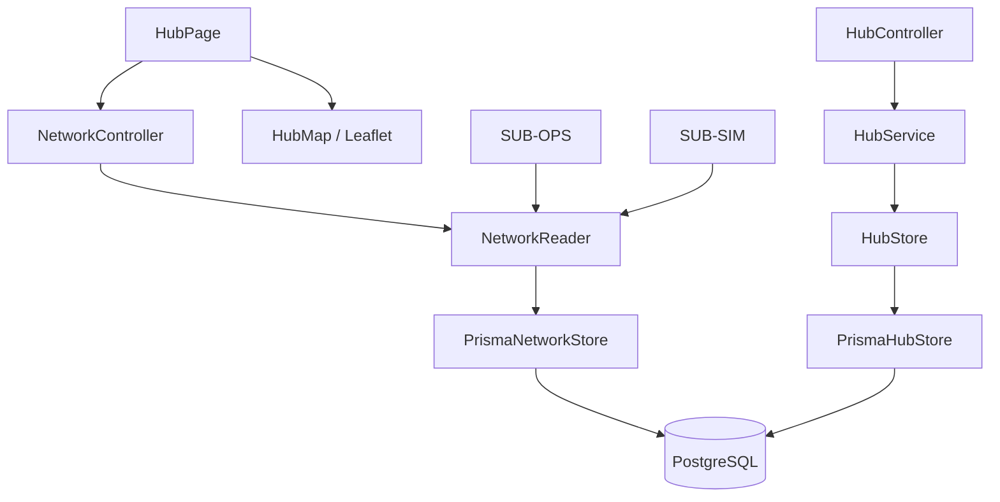

# SUB-HUB – Tra cứu Hub và tài nguyên

## 1. Tổng quan phân hệ

SUB-HUB cung cấp bản đồ và danh sách các Mobility Hub của Smart E-Mobility Hub (SEMH) tại khu đô thị ĐHQG TP.HCM. Sinh viên có thể tìm Hub theo vị trí hoặc nhu cầu, xem số xe dùng chung, chỗ đỗ và cổng sạc khả dụng, rồi tìm Hub gần đó nếu cần đổi điểm đến.

Phân hệ giải quyết vấn đề thông tin tài nguyên phân tán và nhanh lỗi thời (`PB-01`), đáp ứng nhu cầu `SN-STU-01` và các user story `US-HUB-01`, `US-HUB-02`. Snapshot mạng lưới cũng hỗ trợ nhu cầu giám sát của nhân viên vận hành (`SN-OPR-01`).

## 2. Phạm vi và tác nhân

### 2.1. Tác nhân

| Tác nhân | Vai trò trong SUB-HUB |
| --- | --- |
| Sinh viên (`ACT-STU` / `STU`) | Tra cứu công khai hoặc trong cổng Sinh viên. Từ chi tiết Hub, tài khoản Sinh viên có thể chuyển sang luồng đặt xe, đặt chỗ đỗ hoặc đăng ký sạc. |
| Nhân viên vận hành (`ACT-OPR` / `OPR`) | Sử dụng snapshot theo phạm vi Hub được cấp qua màn hình giám sát của SUB-OPS (`UC-OPS-01`). |
| Nguồn bản đồ (`EXT-MAP`) | Cung cấp nền OpenStreetMap cho bản đồ Leaflet. Tọa độ các Hub được lấy từ danh mục của SEMH. |
| IoT & State Data Gateway (`ACT-DAT` / `EXT-STATE`) | Cung cấp sự kiện trạng thái Hub và tài nguyên qua luồng tiếp nhận của SEMH. Tra cứu đọc dữ liệu các phân hệ đã ghi nhận. |

### 2.2. Phạm vi nghiệp vụ

SUB-HUB phụ trách thông tin `MobilityHub`, tổng hợp trạng thái tài nguyên để tra cứu và cung cấp dữ liệu về khả năng tiếp nhận xe cho các phân hệ liên quan. Ba use case tra cứu cho phép đọc và mở cho cả khách vãng lai và khách đã xác thực tài khoản. Kết quả công khai chứa thông tin Hub và thiết bị, gồm mức pin xe khi có dữ liệu. Khi người dùng chuyển sang đặt hoặc sử dụng tài nguyên, phân hệ đích xác thực phiên, kiểm tra quyền và đánh giá lại điều kiện trên dữ liệu hiện hành.

## 3. Các chức năng chính

| Mã yêu cầu | Use case / chức năng | Kết quả |
| --- | --- | --- |
| `FR-HUB-01` | `UC-HUB-01` – Tra cứu Hub phù hợp | Danh sách và bản đồ Hub theo từ khóa, vị trí, bán kính và nhu cầu. |
| `FR-HUB-02` | `UC-HUB-02` – Xem trạng thái tài nguyên tại Hub | Số lượng khả dụng, trạng thái từng tài nguyên, mức pin xe và mốc quan sát gần nhất khi có. |
| `FR-HUB-03` | `UC-HUB-03` – Xem Hub thay thế | Các Hub lân cận có tài nguyên đúng nhu cầu, kèm khoảng cách và số lượng khả dụng. |
| `NIFR-HUB-01` | Cập nhật trạng thái Hub | Tổng hợp lại số liệu từ trạng thái đã lưu mỗi lần đọc snapshot. Giao diện tải lại định kỳ và có thể làm mới khi nhận thông báo thay đổi. |

### 3.1. UC-HUB-01 – Tra cứu Hub phù hợp

1. Người dùng mở **Khám phá Hub**, nhập tên hoặc mã Hub và chọn nhu cầu nếu cần. Ô tìm kiếm gợi ý tối đa tám Hub và cho phép mở thẳng trang chi tiết.
2. Để tìm quanh một vị trí, người dùng mở **Vị trí và bán kính**, dùng vị trí hiện tại của trình duyệt hoặc chọn một Hub làm mốc. Nếu trình duyệt từ chối hoặc không đọc được vị trí, người dùng vẫn có thể chọn Hub làm mốc.
3. Khi bấm **Tìm Hub**, API lọc theo tiêu chí và trả khoảng cách nếu có mốc. Danh sách hiển thị số lượng khả dụng theo từng nhóm. Marker trên bản đồ hiển thị số lượng của dịch vụ đang lọc, mặc định là xe dùng chung.
4. Kết quả rỗng được hiển thị riêng với lỗi tải dữ liệu. Người dùng có thể đổi bộ lọc hoặc bấm **Thử lại** khi tải lỗi.

[Mockup](phase-2/mockups/uc-hub-01.png) · [Biểu đồ tuần tự](phase-2/diagrams/sequence/uc-hub-01.jpg) · [Biểu đồ hoạt động](phase-2/diagrams/activity/uc-hub-01.jpg).

### 3.2. UC-HUB-02 – Xem trạng thái tài nguyên tại Hub

Người dùng chọn một Hub trên danh sách hoặc bản đồ rồi bấm **Xem chi tiết Hub**. `HubPage` dùng tham số `?hub=<id>` để tìm Hub trong kết quả đang có hoặc trong snapshot toàn mạng. Trang chi tiết hiển thị mã, tên, trạng thái phục vụ, ba số đếm khả dụng và khoảng cách nếu kết quả có mốc. Dòng **Cập nhật** lấy `observedAt` mới nhất trong các tài nguyên trả về và chỉ hiện khi có mốc quan sát.

Ba tab **Xe dùng chung**, **Chỗ đỗ** và **Cổng sạc** cho xem mã, trạng thái và thao tác phù hợp. Tab xe hiển thị thêm mức pin. Với xe đủ điều kiện hiển thị nút đặt, khách được dẫn tới đăng nhập, còn Sinh viên đã đăng nhập được chuyển sang SUB-RES với `hubId` và `vehicleId`. Các liên kết đặt chỗ đỗ và đăng ký sạc chuyển `hubId` sang SUB-PARK hoặc SUB-CHG. Nếu ID không có trong snapshot đã tải, giao diện hiển thị **Không tìm thấy Hub này**.

[Mockup](phase-2/mockups/uc-hub-02.png) · [Biểu đồ tuần tự](phase-2/diagrams/sequence/uc-hub-02.jpg) · [Biểu đồ hoạt động](phase-2/diagrams/activity/uc-hub-02.jpg).

### 3.3. UC-HUB-03 – Xem Hub thay thế

Tại chi tiết Hub, chọn tab tài nguyên cần tìm rồi bấm **Tìm Hub thay thế**. Giao diện gửi `alternativeFor` là ID Hub đang xem, `need` là dịch vụ của tab và `radiusKm=5`. API lấy tọa độ của Hub ban đầu làm mốc, loại chính Hub đó và giữ các ứng viên trong bán kính có số lượng khả dụng lớn hơn 0 cho nhu cầu đã chọn.

Danh sách hiển thị khoảng cách và số lượng tài nguyên khả dụng cho nhu cầu đang xét. Người dùng có thể mở chi tiết ứng viên. Nếu không có kết quả trong 5 km, người dùng quay về danh sách Hub để tự chọn mốc và bán kính khác.

[Mockup](phase-2/mockups/uc-hub-03.png) · [Biểu đồ tuần tự](phase-2/diagrams/sequence/uc-hub-03.jpg) · [Biểu đồ hoạt động](phase-2/diagrams/activity/uc-hub-03.jpg).

### 3.4. NIFR-HUB-01 – Cập nhật trạng thái Hub

Luồng tiếp nhận dữ liệu trạng thái xử lý bản tin theo loại tài nguyên. Với bản tin `resource.state` của Hub, SUB-OPS kiểm tra ID Hub, bỏ qua sự kiện có thời điểm quan sát cũ hơn hoặc trùng định danh nguồn và sự kiện, cập nhật `lastObservedAt` và chuyển bản tin báo lỗi sang quy trình xử lý sự cố. Lần đọc snapshot tiếp theo tính lại số lượng khả dụng và cảnh báo từ dữ liệu đã lưu.

Trang công khai tải lại khoảng 10 giây một lần. Trong cổng Sinh viên, `HubPage` đăng ký các chủ đề `vehicle`, `parking`, `charging` qua WebSocket và tải lại API khi nhận thông báo `changed`. Chu kỳ tải định kỳ là khoảng 30 giây khi đã kết nối và khoảng 10 giây khi chưa kết nối. Khi tải lại cùng URL thất bại, hook giữ phản hồi thành công gần nhất. Màn hình danh sách hiển thị lỗi tải và nút **Thử lại**.

## 4. Kiến trúc phân hệ

SUB-HUB là một module nghiệp vụ trong backend NestJS của SEMH. Giao diện dùng React, TypeScript và Leaflet. Hai controller cung cấp dữ liệu đọc từ PostgreSQL qua Prisma, với các kiểu phản hồi dùng chung trong `packages/contracts`.

### 4.1. Mô hình dữ liệu và hợp đồng đọc

| Entity / kiểu | Trách nhiệm và dữ liệu chính |
| --- | --- |
| `MobilityHub` | Lưu UUID, mã duy nhất, tên, mô tả, tọa độ, `vehicleCapacity`, `chargeKw`, `serviceStatus`, `fault`, `lastObservedAt` và `version`. Một Hub liên kết với nhiều xe, chỗ đỗ và cổng sạc. |
| `SharedVehicle` | Xe dùng chung do SUB-TRIP quản lý, có `hubId` có thể rỗng, trạng thái, mức pin và các liên kết giữ xe hoặc điều chuyển phục vụ tính khả dụng. |
| `ParkingSpace`, `ChargingPoint` | Mỗi chỗ đỗ hoặc cổng sạc thuộc một Hub. SUB-PARK và SUB-CHG quản lý trạng thái nghiệp vụ tương ứng. |
| `NetworkHub`, `NetworkResource` | Snapshot gồm thông tin Hub, sức chứa, số xe tại Hub, chỗ tiếp nhận đã giữ, số lượng tài nguyên khả dụng, cảnh báo và danh sách tài nguyên. Mỗi tài nguyên có trạng thái, `observedAt` có thể rỗng và mức pin đối với xe. API mạng lưới bổ sung `distanceKm`. |
| `HubView` | Danh mục rút gọn gồm ID, tên, tọa độ Hub và danh sách xe với ID, mã, trạng thái và pin. |

`ServiceStatus` có ba giá trị `DRAFT`, `ACTIVE`, `INACTIVE`. Khả năng phục vụ còn phụ thuộc cờ lỗi của Hub và trạng thái nghiệp vụ của từng tài nguyên. `TRANSFER_HELD` cho xe đang bị giữ bởi kế hoạch điều chuyển và `RESERVED` cho cổng có phiên sạc `READY` đã đến giờ là các trạng thái hiển thị được suy ra khi dựng snapshot.

`NetworkReader.snapshot()` đọc trong giao dịch `RepeatableRead`. Các phân hệ gọi `NetworkReader.read(tx, hubIds, activeOnly)` khi đã có giao dịch riêng. Khi đọc cho tra cứu công khai, `activeOnly` mặc định là `true`, do đó danh sách chỉ gồm Hub và tài nguyên `ACTIVE`. Hub `ACTIVE` có `fault=true` vẫn có thể xuất hiện trong kết quả không lọc theo nhu cầu, với cả ba số đếm khả dụng bằng 0.

### 4.2. Phương thức thiết kế và hiện thực

| Hợp đồng trong thiết kế | Cách triển khai hiện tại |
| --- | --- |
| `HubService.searchHubs()` và `findAlternativeHubs()` | `NetworkController.list()` kiểm tra đầu vào, đọc snapshot qua `NetworkReader` và tính khoảng cách, lọc, sắp xếp kết quả. |
| `HubService.getHubDetail()` | `HubPage` lấy một Hub từ snapshot công khai bằng ID và dựng trang chi tiết từ `resources`. |
| `HubService.refreshHubStatus()` | `PrismaNetworkStore` tính số đếm và cảnh báo khi đọc. Dữ liệu trạng thái được cập nhật qua các luồng nghiệp vụ và tiếp nhận sự kiện. |
| Tra cứu khả năng tiếp nhận xe | `HubService.readArrivalCapacityInTx()` trả `active`, `physicalSpaces` và `spaces` trong giao dịch của bên gọi, hoặc `null` nếu Hub không tồn tại. `isHubActiveInTx()` kiểm tra `ACTIVE` và cờ lỗi. |

[Sơ đồ lớp trong báo cáo](phase-3/diagrams/class/01-sub-hub.jpg) · [Prisma schema](../apps/api/prisma/schema.prisma).

## 5. Cấu trúc mã nguồn

| File / thư mục | Trách nhiệm |
| --- | --- |
| [`hub.module.ts`](../apps/api/src/modules/hub/hub.module.ts) | Đăng ký controller, store và export `HubService`, `NetworkReader`. |
| [`presentation/network.controller.ts`](../apps/api/src/modules/hub/presentation/network.controller.ts) | Cung cấp snapshot công khai, kiểm tra bộ lọc và xử lý khoảng cách. |
| [`presentation/hub.controller.ts`](../apps/api/src/modules/hub/presentation/hub.controller.ts) | Cung cấp danh mục Hub và xe rút gọn. |
| [`application/`](../apps/api/src/modules/hub/application/) | `HubService`, hợp đồng `HubStore` và `NetworkReader`. |
| [`infrastructure/prisma-network.store.ts`](../apps/api/src/modules/hub/infrastructure/prisma-network.store.ts) | Đọc snapshot nhất quán và tính khả dụng, chỗ tiếp nhận đã giữ, cảnh báo. |
| [`infrastructure/prisma-hub.store.ts`](../apps/api/src/modules/hub/infrastructure/prisma-hub.store.ts) | Đọc danh mục Hub, kiểm tra trạng thái phục vụ và sức chứa còn lại. |
| [`features/hub/`](../apps/web/src/features/hub/) | `HubPage` hiển thị tra cứu và chi tiết. `HubSearchField` gợi ý từ khóa. `HubMap` và `campus-map.ts` hiển thị bản đồ và marker. |
| [`packages/contracts/src/network.ts`](../packages/contracts/src/network.ts) | Khai báo `NetworkHub`, `NetworkResource` và chia sẻ `matchesHubSearch()` giữa frontend và backend. |

## 6. API endpoints

| Phương thức và đường dẫn | Quyền truy cập | Phản hồi |
| --- | --- | --- |
| `GET /api/network/hubs` | Công khai | Mảng snapshot mạng lưới, mỗi Hub có thêm `distanceKm` (`null` khi không có mốc). Trả `[]` nếu không có ứng viên. |
| `GET /api/hubs` | Công khai | Mảng `HubView` theo mã Hub, chỉ gồm Hub `ACTIVE` không lỗi và xe `ACTIVE` không lỗi tại các Hub đó. Xe trong danh mục vẫn có thể có các trạng thái nghiệp vụ khác nhau. |

Tham số của `GET /api/network/hubs` được kết hợp để lọc cùng một snapshot.

| Tham số | Cách xử lý |
| --- | --- |
| `q` | Tìm theo tên hoặc mã Hub sau khi bỏ dấu tiếng Việt và chuyển về chữ thường. Chấp nhận cả mã đã bỏ dấu gạch nối. |
| `need` | Nhận `vehicle`, `parking` hoặc `charging`. Khi có tham số này, Hub phải có ít nhất một tài nguyên khả dụng tương ứng. |
| `latitude`, `longitude` | Cung cấp theo cặp, với vĩ độ từ −90 đến 90 và kinh độ từ −180 đến 180 khi dùng làm mốc. |
| `radiusKm` | Từ 0,1 đến 80 km và cần một mốc tham chiếu. Nếu bỏ trống, API không giới hạn bán kính. |
| `alternativeFor` | UUID của Hub tham chiếu trong snapshot công khai. Tọa độ Hub này được ưu tiên làm mốc và Hub đó được loại khỏi kết quả. |

API trả HTTP `400` khi loại nhu cầu sai, thiếu một tọa độ trong cặp, bán kính ngoài khoảng hỗ trợ hoặc thiếu mốc, hay khi `alternativeFor` không phải UUID hợp lệ hoặc không có trong snapshot công khai.

## 7. Quy tắc tổng hợp và tìm kiếm

### 7.1. Điều kiện tính tài nguyên khả dụng

Theo `BR-HUB-01`, chỗ đỗ và cổng sạc gắn với một Hub, còn tồn xe được tính theo Hub hiện tại của xe. Theo `BR-HUB-02`, Hub cha và tài nguyên phải đang phục vụ, tài nguyên phải ở trạng thái khả dụng và đã hết các ràng buộc sử dụng liên quan. Trong code, `PrismaNetworkStore` yêu cầu Hub `ACTIVE` và không lỗi trước khi áp dụng các điều kiện sau.

| Nhóm tài nguyên | Điều kiện đưa vào số đếm khả dụng |
| --- | --- |
| Xe dùng chung | Xe ở Hub, `ACTIVE`, `AVAILABLE`, pin từ 30%, không lỗi, không có `reservationHoldId` hoặc `transferPlanId`. |
| Chỗ đỗ cá nhân | Chỗ đỗ `ACTIVE`, `AVAILABLE`, không lỗi, có `lastObservedAt` và cảm biến xác nhận `occupied === false`. |
| Cổng sạc | Cổng `ACTIVE`, `AVAILABLE`, không lỗi, có `lastObservedAt` và không có phiên `READY` với `startAt` đã đến. |

`vehicleCount` đếm xe gắn với Hub có trạng thái phục vụ khác `DRAFT` hoặc đã có quan sát. Số này dùng để tính mức lấp đầy, còn `capacity` là sức chứa cấu hình. Với Hub đang phục vụ, không lỗi và có sức chứa dương, `LOW_FLEET` xuất hiện khi số xe khả dụng dưới 15% sức chứa và `NEAR_CAPACITY` xuất hiện khi số xe tại Hub vượt 90% sức chứa.

### 7.2. Sức chứa dành cho xe đến

`readArrivalCapacityInTx()` lấy sức chứa cấu hình trừ số xe đang được tính tại Hub, chặn kết quả tối thiểu bằng 0 để có `physicalSpaces`. `spaces` tiếp tục trừ các chỗ tiếp nhận đã giữ cho xe có mục điều chuyển `PLANNED` hoặc `DEPARTED` trong kế hoạch tới Hub đó đang `APPROVED`, `IN_PROGRESS` hoặc `AWAITING_APPROVAL`. Snapshot mạng lưới công bố số chỗ đã giữ qua `heldArrivals`. Bên gọi kiểm tra riêng cờ `active` khi quyết định tiếp nhận xe.

### 7.3. Lọc theo vị trí và nhu cầu

Từ khóa được so khớp theo chuỗi con hoặc theo tiền tố của từng từ trong tên và mã. Khi có mốc, API tính khoảng cách đường chim bay theo công thức Haversine, lấy kết quả trong bán kính và sắp xếp gần trước. Nếu không có mốc, danh sách giữ thứ tự mã Hub từ store. Với bộ lọc nhu cầu, số lượng khả dụng được dùng để kiểm tra Hub có đáp ứng hay không.

## 8. Tích hợp với các phân hệ khác

| Thành phần | Quan hệ với SUB-HUB |
| --- | --- |
| GEN | Quản lý phiên, vai trò và phạm vi Hub. Quyền truy cập được kiểm tra khi người dùng chuyển từ tra cứu sang thao tác nghiệp vụ. |
| SUB-RES và SUB-TRIP | RES kiểm tra lại điều kiện đặt xe và quản lý lượt giữ. TRIP quản lý trạng thái, pin và vị trí xe, đồng thời đọc sức chứa tiếp nhận của Hub khi trả xe. |
| SUB-PARK | Quản lý trạng thái chỗ đỗ và kiểm tra Hub đang phục vụ trong luồng đặt chỗ, check-in và xử lý lượt giữ liên quan. |
| SUB-CHG | Quản lý cổng và phiên sạc. Trạng thái cổng và phiên đến giờ đi vào snapshot, còn việc lập lịch dùng cấu hình công suất `chargeKw` của Hub. |
| SUB-OPS | Đọc `NetworkReader` trong giao dịch lấy dashboard, theo phạm vi được cấp. Sử dụng kiểm tra phục vụ và sức chứa của Hub trong luồng sự cố và điều chuyển. |
| SUB-SIM | Đọc snapshot làm dữ liệu đầu vào mô phỏng và đánh giá lại dữ liệu hiện tại khi chuẩn bị phương án từ khuyến nghị. |
| IoT Simulator | Gửi sự kiện qua API tiếp nhận dữ liệu trạng thái để các phân hệ cập nhật bản ghi mà snapshot sử dụng. |

## 9. Kịch bản kiểm thử

Các kịch bản `TC-HUB-01` đến `TC-HUB-03` dựa trên Bảng 98, trang in 229 của báo cáo. Kết quả dưới đây là kỳ vọng khi kiểm tra phiên bản hiện tại.

| Kịch bản | Điều kiện và thao tác | Kết quả mong đợi |
| --- | --- | --- |
| `TC-HUB-01` | Tra cứu khi chưa đăng nhập, thử tên có và không dấu, chọn mốc, bán kính và nhu cầu. Thử một vùng không có ứng viên. | Kết quả đúng tiêu chí, khoảng cách tăng dần khi có mốc. Vùng không có ứng viên trả `[]` và giao diện báo không có Hub phù hợp. |
| `TC-HUB-02` | Mở Hub có xe pin 29% và 30%, xe đang được giữ, chỗ đỗ có và thiếu quan sát, cổng có phiên `READY` đã đến giờ. Cập nhật một tài nguyên bằng sự kiện hợp lệ rồi tải lại. | Số đếm phản ánh các điều kiện ở mục 7.1, bảng hiển thị trạng thái và pin theo snapshot mới, dòng **Cập nhật** phản ánh mốc quan sát gần nhất trong dữ liệu trả về. |
| `TC-HUB-03` | Tại Hub A, tìm thay thế ở một tab dịch vụ. Chuẩn bị Hub B trong 5 km còn tài nguyên và Hub C ở ngoài bán kính hoặc hết tài nguyên. | Danh sách có B kèm khoảng cách và số lượng khả dụng, loại A và C. Mở được chi tiết B. Khi B cũng hết tài nguyên, danh sách rỗng. |
| Đầu vào không hợp lệ | Gọi API với một tọa độ, bán kính mà không có mốc hoặc `alternativeFor` không tồn tại. | API trả HTTP `400`. |
| Lỗi tải và dữ liệu thay đổi | Tải thành công, làm cho lần tải lại cùng bộ lọc thất bại rồi khôi phục kết nối. | Danh sách giữ kết quả đã tải, hiển thị lỗi và cho phép thử lại. Kết quả được cập nhật khi API trả về thành công. |

Repo có kiểm thử tích hợp cho việc phản ánh pin hợp lệ qua `/api/hubs`, số chỗ tiếp nhận đã giữ khi điều chuyển qua `/api/network/hubs` và thời điểm xe được đưa trở lại danh mục rút gọn sau khi xử lý sự cố. [Kiểm thử nền tảng](../apps/api/test/foundation.test.mjs) · [Kiểm thử luồng tích hợp](../apps/api/test/final-flows.test.mjs).

## 10. Hướng dẫn demo

1. Chạy và seed hệ thống theo [README của dự án](../README.md). Từ trang đăng nhập, chọn **Tra cứu Hub không cần đăng nhập** để mở `/hubs`.
2. Nhập `metro`, thử chọn gợi ý hoặc bấm **Tìm Hub**. Chọn thêm nhu cầu, dùng một Hub làm mốc và đặt bán kính 5 km để kiểm tra thứ tự khoảng cách.
3. Chọn marker hoặc một Hub trong danh sách, bấm **Xem chi tiết Hub** và đối chiếu ba số đếm với các tab tài nguyên. Xem mức pin ở tab **Xe dùng chung**.
4. Từ một tab, bấm **Tìm Hub thay thế**. Kiểm tra Hub xuất phát đã bị loại và số lượng ở kết quả tương ứng với tab đã chọn. Mở chi tiết một ứng viên nếu có.
5. Đăng nhập tài khoản Sinh viên và mở **Khám phá Hub** tại `/student/hubs`. Chọn một xe có nút **Đặt xe** để quan sát dữ liệu Hub và xe được chuyển sang luồng đặt.