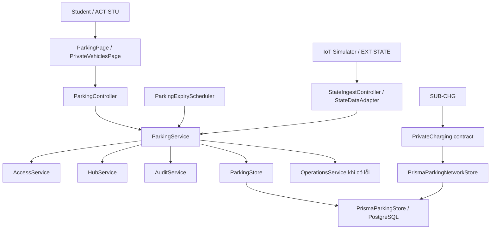

# SUB-PARK – Quản lý chỗ đỗ xe cá nhân

## 1. Tổng quan phân hệ

SUB-PARK quản lý phương tiện cá nhân đã đăng ký, chỗ đỗ tại các Mobility Hub và lượt đặt chỗ đỗ của sinh viên. Phân hệ hỗ trợ sinh viên giữ trước một chỗ đỗ, xác nhận phương tiện đã đến đúng chỗ (check-in), xác nhận phương tiện đã rời chỗ (check-out) và theo dõi lịch sử sử dụng.

Do trạng thái chỗ đỗ phụ thuộc vào dữ liệu cảm biến, hệ thống không xem thao tác bấm nút của người dùng là bằng chứng xe đã vào hoặc rời chỗ. SUB-PARK tiếp nhận yêu cầu xác minh, chờ sự kiện từ IoT & State Data Gateway hoặc bộ giả lập, sau đó mới cập nhật trạng thái lượt đặt và chỗ đỗ.

SUB-PARK đáp ứng nhu cầu `SN-STU-04`, các user story `US-PARK-01`, `US-PARK-02` và các yêu cầu `FR-PARK-01`, `FR-PARK-02`, `FR-PARK-03` trong báo cáo phân tích và thiết kế hệ thống.

## 2. Phạm vi và tác nhân

### 2.1. Tác nhân

| Tác nhân | Vai trò trong SUB-PARK |
| --- | --- |
| Sinh viên (`ACT-STU` / `STU`) | Đăng ký xe cá nhân; đặt, hủy, check-in, check-out và theo dõi các lượt đỗ thuộc quyền của mình. |
| IoT & State Data Gateway (`ACT-DAT` / `EXT-STATE`) | Cung cấp dữ liệu hiện diện, tình trạng và sự cố của chỗ đỗ; nhận yêu cầu xác minh đang chờ và gửi sự kiện phản hồi. |
| Nhân viên vận hành (`ACT-OPR` / `OPR`) | Quản lý trạng thái phục vụ của chỗ đỗ và tiếp nhận thông tin sự cố thông qua SUB-OPS trong phạm vi Hub được giao. |
| Nhân viên kỹ thuật (`ACT-MNT` / `MNT`) | Xử lý sự cố được giao và xác nhận kết quả khắc phục theo quy trình SUB-OPS. |

OPR và MNT không gọi trực tiếp các nghiệp vụ đặt chỗ của SUB-PARK. Quản lý danh mục, trạng thái phục vụ và vòng đời sự cố của tài nguyên được thực hiện qua SUB-OPS. Xác thực, phiên đăng nhập và phân quyền thuộc GEN; thông tin Hub thuộc SUB-HUB.

### 2.2. Phạm vi nghiệp vụ

SUB-PARK chịu trách nhiệm quản lý:

- Xe cá nhân (`PrivateVehicle`) và quyền sở hữu xe.
- Chỗ đỗ (`ParkingSpace`) thuộc một Mobility Hub.
- Lượt đặt chỗ (`ParkingReservation`) và vòng đời đặt, hủy, hết hạn, check-in, check-out.
- Yêu cầu xác minh (`ParkingVerification`) và việc áp dụng sự kiện trạng thái chỗ đỗ từ IoT.
- Trạng thái sử dụng của chỗ đỗ và việc bảo toàn trạng thái an toàn khi chỗ gặp sự cố.

Điều khiển thiết bị/cảm biến vật lý, thanh toán, quản lý tài khoản, quản lý Hub và quy trình sửa chữa không thuộc phạm vi trực tiếp của SUB-PARK. Dữ liệu IoT trong môi trường demo có thể được cung cấp bởi simulator.

## 3. Các chức năng chính

| Mã yêu cầu | Use case / chức năng | Mô tả |
| --- | --- | --- |
| `FR-PARK-01` | `UC-PARK-01` – Đặt trước chỗ đỗ | Tạo lượt `ParkingReservation` cho một chỗ `Available` tại Hub còn phục vụ và trả thời điểm hết hạn. |
| `FR-PARK-02` | `UC-PARK-02` – Check-in phương tiện cá nhân | Xác minh lượt đặt còn hiệu lực và có bằng chứng đúng xe đã đến đúng chỗ; cập nhật lượt đặt và chỗ đỗ. |
| `FR-PARK-03` | `UC-PARK-03` – Check-out phương tiện cá nhân | Xác minh xe đã rời chỗ; hoàn tất lượt đỗ và chỉ giải phóng chỗ khi trạng thái an toàn. |
| `NIFR-PARK-01` | Giải phóng chỗ đỗ hết hạn | Tự động chuyển lượt `Confirmed` chưa check-in sang `Expired` và xử lý giải phóng chỗ theo trạng thái thực tế. |

### 3.1. UC-PARK-01 – Đặt chỗ đỗ cho xe cá nhân

Sinh viên mở mục **Chỗ đỗ**, chọn Hub và xe cá nhân đã đăng ký. Giao diện hiển thị số chỗ có thể đặt tại từng Hub và thời hạn giữ chỗ. Người dùng không chọn trực tiếp mã chỗ; backend tự chọn một chỗ phù hợp trong Hub.

Quy trình xử lý:

1. Backend xác minh phiên đăng nhập, vai trò `STU` và quyền sở hữu xe cá nhân được chọn.
2. Hệ thống kiểm tra Hub đang `ACTIVE`.
3. Hệ thống xử lý các lượt `Confirmed` đã hết hạn tại Hub trước khi tìm chỗ mới.
4. `PrismaParkingStore` tìm chỗ có `ServiceStatus = ACTIVE`, `status = AVAILABLE`, `occupied = false`, không có lỗi và đã có dữ liệu quan sát.
5. Trong giao dịch `Serializable`, hệ thống kiểm tra xe chưa có lượt đỗ đang hiệu lực, tạo `ParkingReservation` ở trạng thái `CONFIRMED`, đặt `expiresAt` sau tối đa 20 phút và chuyển `ParkingSpace` sang `RESERVED`.
6. Hệ thống ghi audit và trả mã lượt đặt, Hub, mã chỗ, xe và thời điểm hết hạn.

Nếu không còn chỗ phù hợp, backend từ chối yêu cầu để sinh viên chọn Hub khác. Nếu hai yêu cầu cạnh tranh cùng một chỗ, giao dịch chỉ cho phép một yêu cầu được xác nhận. `requestId` giúp nhận lại kết quả đã tạo khi client gửi lại cùng thao tác; dùng lại ID với Hub hoặc xe khác bị từ chối.

Xe cá nhân đã có lượt `CONFIRMED` hoặc `CHECKED_IN` không thể tạo thêm lượt đỗ mới. Xe phải thuộc sinh viên đang đăng nhập; gửi ID xe của người khác không làm lộ dữ liệu xe đó.

Tài liệu thiết kế: [Use-case diagram](phase-1/diagrams/plantuml/output/uc-park-01.svg) · [Sequence diagram](phase-2/diagrams/sequence/uc-park-01.svg) · [Activity diagram](phase-2/diagrams/activity/uc-park-01.svg).

### 3.2. UC-PARK-02 – Check-in phương tiện cá nhân

Sinh viên mở lượt `CONFIRMED` còn hạn và chọn **Check-in**. Backend kiểm tra lượt đặt thuộc đúng sinh viên, xe, Hub và chỗ; chỗ phải đang `RESERVED`, có `ServiceStatus = ACTIVE` và Hub còn hoạt động.

Thao tác check-in không lập tức chuyển lượt đặt sang `CHECKED_IN`. Backend tạo một `ParkingVerification` loại `CHECK_IN` ở trạng thái `PENDING`. IoT Simulator hoặc nguồn IoT đọc hàng đợi tại `GET /state-events/parking-verifications`, sau đó gửi sự kiện `parking.state` có `verificationId`, `spaceId`, `privateVehicleId` và `occupied = true`.

Chỉ khi sự kiện hợp lệ xác nhận đúng xe hiện diện tại đúng chỗ, backend mới cập nhật trong cùng giao dịch:

- `ParkingReservation`: `CONFIRMED` → `CHECKED_IN`.
- `ParkingSpace`: `RESERVED` → `OCCUPIED`.
- Ghi `checkInAt` và audit tương ứng.

Nếu cảm biến chưa cập nhật, sai xe, sai chỗ, dữ liệu cũ, yêu cầu hết hạn hoặc chỗ có lỗi, hệ thống không xác nhận check-in. Yêu cầu xác minh có thời hạn tối đa 90 giây; với check-in, thời hạn này không vượt quá thời điểm hết hạn lượt đặt.

Tài liệu thiết kế: [Use-case diagram](phase-1/diagrams/plantuml/output/uc-park-02.svg) · [Sequence diagram](phase-2/diagrams/sequence/uc-park-02.svg) · [Activity diagram](phase-2/diagrams/activity/uc-park-02.svg).

### 3.3. UC-PARK-03 – Check-out phương tiện cá nhân

Sinh viên mở lượt `CHECKED_IN` và chọn **Check-out**. Backend tạo yêu cầu xác minh loại `CHECK_OUT`. IoT Simulator lấy yêu cầu đang chờ và gửi sự kiện `parking.state` cho đúng chỗ với `occupied = false`.

Nếu cảm biến xác nhận chỗ đã trống, backend cập nhật lượt đặt sang `COMPLETED`, ghi `checkOutAt` và audit. Chỗ đỗ chỉ trở về `AVAILABLE` khi dữ liệu hiện diện cho biết chỗ trống và không có lỗi. Nếu sự kiện đồng thời báo lỗi, lượt đỗ vẫn có thể hoàn tất nhưng chỗ chuyển sang `OUT_OF_SERVICE`, không được cấp phát lại.

Nếu cảm biến vẫn báo có xe, không có dữ liệu hợp lệ hoặc hết thời gian xác minh, hệ thống giữ nguyên trạng thái đang đỗ và không giải phóng chỗ. Gửi lại cùng yêu cầu xác minh không tạo tác động trùng.

Tài liệu thiết kế: [Use-case diagram](phase-1/diagrams/plantuml/output/uc-park-03.svg) · [Sequence diagram](phase-2/diagrams/sequence/uc-park-03.svg) · [Activity diagram](phase-2/diagrams/activity/uc-park-03.svg).

### 3.4. Hủy lượt đặt chỗ

Sinh viên chỉ được hủy lượt `CONFIRMED` của chính mình trước khi check-in. Lượt đã `CHECKED_IN` không thể hủy bằng thao tác này; sinh viên phải hoàn tất check-out khi xe đã rời chỗ và có bằng chứng phù hợp.

Khi hủy, hệ thống chuyển lượt sang `CANCELLED`, ghi audit và tính lại trạng thái chỗ dựa trên dữ liệu quan sát đã lưu. Chỗ có lỗi hoặc chưa có thông tin hiện diện không được tự động chuyển về `AVAILABLE`. Yêu cầu hủy lặp đối với lượt đã `CANCELLED` hoặc `EXPIRED` trả lại kết quả hiện tại thay vì thực hiện lại thay đổi.

### 3.5. NIFR-PARK-01 – Giải phóng chỗ đỗ hết hạn

`ParkingExpiryScheduler` chạy một lượt khi module khởi tạo và quét các lượt `CONFIRMED` đã đến hạn mỗi 30 giây. Scheduler không khởi chạy chồng khi lần quét trước còn đang thực hiện.

Với từng lượt đến hạn, service kiểm tra lại trạng thái trong giao dịch `Serializable`. Chỉ lượt còn `CONFIRMED` và có `expiresAt` không sau thời điểm hiện tại mới được chuyển sang `EXPIRED`; lượt đã `CHECKED_IN` không bị tác vụ hết hạn thay đổi.

Sau khi hết hạn, chỗ chỉ được mở lại nếu dữ liệu hiện diện đã lưu cho biết chỗ trống và không có lỗi. Nếu `occupied` chưa xác định, chưa có thời điểm quan sát hoặc chỗ có lỗi, trạng thái được giữ an toàn (`OUT_OF_SERVICE`) thay vì mặc định thành `AVAILABLE`.

## 4. Kiến trúc phân hệ

SUB-PARK là module nghiệp vụ trong backend modular monolith của SEMH, không phải microservice triển khai độc lập. Frontend dùng React và TypeScript; backend dùng NestJS; dữ liệu được lưu trong PostgreSQL qua Prisma. Các kiểu dữ liệu dùng chung được định nghĩa trong `packages/contracts`.



Các lớp được phân chia theo trách nhiệm:

- **Presentation:** `ParkingController` tiếp nhận REST request, kiểm tra đầu vào và giới hạn vai trò `STU`.
- **Application:** `ParkingService` điều phối tra cứu, đăng ký xe, đặt/hủy chỗ, tạo yêu cầu xác minh, áp dụng sự kiện IoT, hết hạn và ghi audit.
- **Domain:** `parking.policy.ts` chứa thời hạn giữ chỗ, thời hạn xác minh, trạng thái cần có cho từng loại xác minh và quy tắc suy ra trạng thái chỗ.
- **Infrastructure:** `PrismaParkingStore` hiện thực `ParkingStore` bằng Prisma/PostgreSQL; `ParkingExpiryScheduler` kích hoạt xử lý hết hạn; `PrismaParkingNetworkStore` cung cấp hợp đồng xe cá nhân cho SUB-CHG.
- **Tích hợp dùng chung:** GEN kiểm tra quyền; HUB cung cấp trạng thái Hub; StateDataAdapter xác thực nguồn IoT và chuyển sự kiện đến PARK; OPS tiếp nhận sự cố tài nguyên.

### 4.1. Mô hình dữ liệu

| Entity | Trách nhiệm và dữ liệu chính |
| --- | --- |
| `PrivateVehicle` | Lưu biển số, chủ sở hữu (`ownerId`), thời điểm gỡ khỏi danh sách (`removedAt`) và dữ liệu pin/phục vụ sạc. Xe được gỡ bằng soft delete để giữ lịch sử đặt chỗ và sạc. |
| `ParkingSpace` | Lưu mã chỗ, Hub, `ServiceStatus`, trạng thái sử dụng, nguồn IoT, `occupied`, `fault`, `lastObservedAt` và `version`. |
| `ParkingReservation` | Liên kết sinh viên, xe cá nhân và chỗ đỗ; lưu `requestId`, trạng thái, `confirmedAt`, `expiresAt`, `checkInAt` và `checkOutAt`. |
| `ParkingVerification` | Lưu yêu cầu xác minh check-in/check-out, `requestId`, lượt đặt liên quan, trạng thái, thời hạn và lý do từ chối nếu có. |
| `StateEventRecord` | Lưu cặp `sourceId`/`eventId` đã nhận để chống áp dụng một sự kiện IoT nhiều lần. |

Một `ParkingReservation` thuộc đúng một sinh viên, một xe cá nhân và một chỗ đỗ. `ParkingReservation` có unique key theo `(studentId, requestId)`; `ParkingVerification` có unique key theo `(reservationId, requestId)`. Các ràng buộc này hỗ trợ xử lý gửi lại yêu cầu. `ParkingSpace` thuộc một Hub; nhiều lượt đặt có thể tham chiếu cùng chỗ ở các thời điểm khác nhau.

Tham khảo [Prisma schema](../apps/api/prisma/schema.prisma) và [class diagram SUB-PARK](phase-3/diagrams/class/04-sub-park.svg).

### 4.2. Trạng thái trong phiên bản hiện tại

| Đối tượng | Trạng thái trong Prisma |
| --- | --- |
| `ParkingReservation` | `CONFIRMED`, `CHECKED_IN`, `COMPLETED`, `CANCELLED`, `EXPIRED` |
| `ParkingSpace` | `AVAILABLE`, `RESERVED`, `OCCUPIED`, `OUT_OF_SERVICE` |
| `ParkingVerification` | `PENDING`, `APPLIED`, `REJECTED` |
| `ServiceStatus` | `DRAFT`, `ACTIVE`, `INACTIVE` |

`ServiceStatus` độc lập với trạng thái sử dụng/vật lý. Chỗ chỉ đủ điều kiện cấp phát khi đang `ACTIVE` và trạng thái sử dụng là `AVAILABLE`, đồng thời có dữ liệu xác nhận chỗ trống và không có lỗi.

Báo cáo thiết kế và state diagram có liệt kê `Pending`, `Rejected` cho `ParkingReservation`; tuy nhiên enum Prisma hiện tại không có hai trạng thái này. `PENDING`, `APPLIED`, `REJECTED` thuộc `ParkingVerification`, không phải trạng thái lượt đặt chỗ. Trong implementation, UC-PARK-01 tạo trực tiếp lượt `CONFIRMED`; chưa có quy trình duyệt thủ công cho lượt đặt `Pending`.

Tham khảo: [ParkingReservation state diagram](phase-2/diagrams/state/parking-reservation.svg) · [ParkingSpace state diagram](phase-2/diagrams/state/parking-space.svg).

## 5. Cấu trúc source code

| File / thư mục | Trách nhiệm |
| --- | --- |
| [`park.module.ts`](../apps/api/src/modules/park/park.module.ts) | Khai báo module, controller, service, store, scheduler và provider `PrivateCharging`. |
| [`presentation/parking.controller.ts`](../apps/api/src/modules/park/presentation/parking.controller.ts) | Định nghĩa REST endpoint cho xe cá nhân, lượt đặt, hủy, check-in và check-out; yêu cầu vai trò `STU`. |
| [`application/parking.service.ts`](../apps/api/src/modules/park/application/parking.service.ts) | Xử lý đăng ký/gỡ xe, overview, đặt/hủy chỗ, xác minh, sự kiện IoT, hết hạn và audit. |
| [`application/parking-store.port.ts`](../apps/api/src/modules/park/application/parking-store.port.ts) | Khai báo hợp đồng lưu trữ và các kiểu dữ liệu nội bộ của PARK. |
| [`application/private-charging.port.ts`](../apps/api/src/modules/park/application/private-charging.port.ts) | Khai báo hợp đồng cung cấp dữ liệu xe cá nhân cho SUB-CHG. |
| [`domain/parking.policy.ts`](../apps/api/src/modules/park/domain/parking.policy.ts) | Định nghĩa thời hạn giữ chỗ/xác minh và quy tắc suy ra trạng thái chỗ đỗ. |
| [`infrastructure/prisma-parking.store.ts`](../apps/api/src/modules/park/infrastructure/prisma-parking.store.ts) | Truy xuất/cập nhật dữ liệu PARK bằng Prisma; dùng transaction `Serializable` cho nghiệp vụ ghi. |
| [`infrastructure/parking-expiry.scheduler.ts`](../apps/api/src/modules/park/infrastructure/parking-expiry.scheduler.ts) | Quét lượt đặt đã hết hạn mỗi 30 giây, không chạy chồng. |
| [`infrastructure/prisma-parking-network.store.ts`](../apps/api/src/modules/park/infrastructure/prisma-parking-network.store.ts) | Hiện thực `PrivateCharging` để SUB-CHG đọc xe cá nhân và ghi nhận pin. |
| [`ParkingPage.tsx`](../apps/web/src/features/park/ParkingPage.tsx) | Giao diện đặt chỗ, xem lượt đỗ, check-in, check-out, hủy và lịch sử. |
| [`PrivateVehiclesPage.tsx`](../apps/web/src/features/park/PrivateVehiclesPage.tsx) | Giao diện danh sách, thêm và gỡ xe cá nhân. |
| [`PrivateVehicleForm.tsx`](../apps/web/src/features/park/PrivateVehicleForm.tsx) | Biểu mẫu nhập biển số và mức pin ban đầu tùy chọn. |
| [`parking-api.ts`](../apps/web/src/features/park/parking-api.ts) | Các hàm gọi API PARK từ frontend. |
| [`state-data.adapter.ts`](../apps/api/src/integrations/state-ingest/state-data.adapter.ts) | Xác thực nguồn và chuyển sự kiện `parking.state` đến `ParkingService`. |
| [`parking.test.mjs`](../apps/api/test/parking.test.mjs) | Integration test cho đặt chỗ cạnh tranh, xác minh, check-out, lỗi và hết hạn. |

## 6. API endpoints

Các đường dẫn dưới đây tương đối so với API base `/api`.

### 6.1. API cho Sinh viên

| Method | Endpoint | Vai trò | Chức năng |
| --- | --- | --- | --- |
| `GET` | `/parking` | STU | Lấy tổng quan xe cá nhân, Hub và số chỗ khả dụng, lượt đặt đang hiệu lực và lịch sử gần đây. |
| `POST` | `/parking/vehicles` | STU | Đăng ký xe cá nhân bằng `plate`; `batteryPercent` ban đầu là tùy chọn. |
| `DELETE` | `/parking/vehicles/:vehicleId` | STU | Gỡ xe của chính sinh viên; từ chối nếu xe còn lượt đỗ hoặc yêu cầu/phiên sạc đang hiệu lực. |
| `POST` | `/parking/reservations` | STU | Tạo lượt đặt với `requestId`, `hubId`, `privateVehicleId`. |
| `POST` | `/parking/reservations/:reservationId/cancel` | STU | Hủy lượt `CONFIRMED` chưa check-in. |
| `POST` | `/parking/reservations/:reservationId/check-in` | STU | Tạo yêu cầu xác minh check-in; body có `requestId`. |
| `POST` | `/parking/reservations/:reservationId/check-out` | STU | Tạo yêu cầu xác minh check-out; body có `requestId`. |

Controller dùng `AccessGuard` và `@Roles('STU')`. Các thao tác ghi từ trình duyệt sử dụng phiên đăng nhập và CSRF token. Không có endpoint riêng để đọc một reservation theo ID; `GET /parking` trả overview và danh sách lượt đặt thuộc sinh viên.

### 6.2. API tích hợp IoT

| Method | Endpoint | Nguồn | Chức năng |
| --- | --- | --- | --- |
| `GET` | `/state-events/parking-verifications` | IoT Simulator / EXT-STATE | Lấy các yêu cầu xác minh check-in/check-out đang chờ của nguồn IoT. |
| `POST` | `/state-events` | IoT Simulator / EXT-STATE | Gửi sự kiện `parking.state` gồm `eventId`, `sourceId`, `spaceId`, `verificationId`, `privateVehicleId`, `occupied`, `fault`, `observedAt`. |

Các endpoint IoT yêu cầu header `x-iot-source-key`. `StateDataAdapter` kiểm tra khóa nguồn, `sourceId`, mã sự kiện, định dạng và thời điểm bản tin trước khi chuyển sự kiện đến phân hệ sở hữu tài nguyên.

## 7. Quy tắc nghiệp vụ và xử lý trạng thái

### 7.1. Quy tắc nghiệp vụ

| Mã quy tắc | Nội dung |
| --- | --- |
| `BR-PARK-01` | Một chỗ đỗ chỉ có tối đa một lượt đặt đang hiệu lực; chỉ chỗ `Available` mới được giữ. Kiểm tra và giữ chỗ phải ngăn hai yêu cầu đồng thời cùng được xác nhận. |
| `BR-PARK-02` | Lượt `Confirmed` có hiệu lực tối đa 20 phút. Nếu chưa check-in khi hết hạn, lượt chuyển `Expired`; chỗ chỉ được mở lại khi trạng thái thực tế an toàn. |

Trong implementation hiện tại, tập lượt đặt đang ràng buộc chỗ/xe gồm `CONFIRMED` và `CHECKED_IN`. `ParkingReservation` được tạo trực tiếp ở `CONFIRMED`; không có luồng duyệt `PENDING`.

### 7.2. Giữ chỗ

`parkingExpiry()` tính `expiresAt` bằng thời điểm xác nhận cộng `parkingHoldMinutes` (20 phút). `findAvailableSpace()` chỉ chọn chỗ có `ServiceStatus = ACTIVE`, `status = AVAILABLE`, `occupied = false`, `fault = false`, đã có `lastObservedAt` và không có lượt `CONFIRMED`/`CHECKED_IN` khác. Nếu có nhiều chỗ phù hợp, implementation chọn theo `code` tăng dần.

Các thao tác tạo reservation, cập nhật trạng thái chỗ và ghi audit nằm trong cùng transaction `Serializable`. Nếu transaction thất bại, không được để lại lượt đặt hoặc trạng thái giữ chỗ đơn lẻ.

### 7.3. Xác minh sự kiện IoT

`parkingVerificationTimeoutMs` là 90.000 ms. Backend chỉ áp dụng sự kiện nếu:

1. Chỗ đỗ tồn tại và thuộc đúng `sourceId`.
2. `verificationId` (nếu có) tham chiếu yêu cầu đang `PENDING` và đúng chỗ.
3. Bản tin không quá cũ, không vượt quá 5 giây trong tương lai và không cũ hơn lần quan sát đã lưu.
4. Cặp `sourceId`/`eventId` chưa được ghi nhận trước đó.
5. Với check-in, lượt còn `CONFIRMED`, chưa hết hạn, chỗ và Hub đủ điều kiện, cảm biến báo `occupied = true` và `privateVehicleId` khớp xe của lượt đặt.
6. Với check-out, lượt còn `CHECKED_IN` và cảm biến báo `occupied = false`.

Sự kiện trùng trả kết quả `duplicate`; sự kiện cũ hoặc không còn phù hợp trả `stale`; bằng chứng không thỏa điều kiện nghiệp vụ được ghi nhận là `rejected`. Khi có lỗi phần cứng, chỗ chuyển `OUT_OF_SERVICE` và SUB-OPS được thông báo trong cùng luồng xử lý.

### 7.4. Bảo toàn trạng thái chỗ đỗ

`parkingSpaceStatus()` không mặc định chuyển chỗ về `AVAILABLE` khi hủy hoặc hết hạn:

- Có lỗi, chưa có dữ liệu hiện diện hoặc `occupied` chưa xác định: `OUT_OF_SERVICE`.
- Còn lượt `CHECKED_IN`: `OCCUPIED`.
- Còn lượt `CONFIRMED`: `RESERVED`.
- Không còn lượt ràng buộc, dữ liệu xác nhận trống và không lỗi: `AVAILABLE`.
- Check-out thành công nhưng có lỗi: reservation có thể `COMPLETED`, trong khi chỗ vẫn `OUT_OF_SERVICE`.

`ServiceStatus` không được thay đổi bởi telemetry. Chỗ chỉ được cấp phát khi cả trạng thái phục vụ và trạng thái sử dụng đều đáp ứng điều kiện.

## 8. Tích hợp với các phân hệ khác

| Thành phần | Quan hệ với SUB-PARK |
| --- | --- |
| GEN | Cung cấp `AccessService` để kiểm tra phiên, vai trò và quyền sở hữu; `AuditService` ghi nhận thay đổi nghiệp vụ. |
| SUB-HUB | Cung cấp danh sách Hub và kiểm tra Hub còn `ACTIVE` trước khi giữ chỗ. |
| SUB-OPS | Nhận sự kiện lỗi chỗ đỗ; quản lý trạng thái phục vụ, sự cố, giao việc kỹ thuật và khôi phục tài nguyên sau xác minh an toàn. |
| SUB-CHG | Đọc danh sách xe cá nhân, thông tin chủ xe, pin, dung lượng, công suất và đầu nối qua hợp đồng `PrivateCharging`; ghi nhận mức pin qua adapter của PARK. |
| IoT Simulator / EXT-STATE | Poll yêu cầu xác minh và gửi sự kiện hiện diện/trạng thái chỗ đỗ. |

`PrismaParkingNetworkStore` hiện thực `PrivateCharging` và được `ParkModule` cung cấp cho SUB-CHG. Việc gỡ xe cá nhân bị từ chối nếu xe còn yêu cầu sạc hoặc phiên sạc chưa được giải phóng.

Với tài nguyên `PARKING_SPACE`, implementation hiện tại của SUB-OPS dùng `PrismaResourceOwnerAdapter` để đọc/cập nhật dữ liệu chỗ trong transaction của OPS. Sự cố từ IoT được `StateDataAdapter` chuyển đến `ParkingService` và `OperationsService.reportVerifiedFaultInTx()`.

## 9. Kịch bản kiểm thử

Các ca trong báo cáo Phase 3 mô tả kết quả mong đợi; chúng không tự chứng minh rằng toàn bộ kiểm thử đã được chạy thành công.

| Test case | Điều kiện và thao tác | Kết quả mong đợi |
| --- | --- | --- |
| `TC-PARK-01` | STU đặt chỗ `Available` cho xe cá nhân thuộc mình tại Hub A. | Reservation `CONFIRMED`, chỗ `RESERVED` trong cùng giao dịch; hạn giữ không quá 20 phút. Sai chủ xe hoặc chỗ không đủ điều kiện bị từ chối. |
| `TC-PARK-02` | Lượt `CONFIRMED` còn hạn, đúng chủ/xe/chỗ và có bằng chứng hiện diện. | Reservation `CHECKED_IN`, chỗ `OCCUPIED`, ghi `checkInAt`. |
| `TC-PARK-03` | Lượt `CHECKED_IN`; cảm biến xác nhận xe đã rời chỗ rồi thực hiện check-out. | Reservation `COMPLETED`, ghi `checkOutAt`; chỗ chỉ `AVAILABLE` nếu an toàn, có lỗi thì giữ `OUT_OF_SERVICE`. |
| Bổ sung – đặt đồng thời | Hai sinh viên gửi yêu cầu cùng một chỗ trong cùng thời điểm. | Chỉ một lượt được xác nhận; yêu cầu còn lại bị từ chối, không có hai lượt hiệu lực trên cùng chỗ. |
| Bổ sung – gửi lại request | Gửi lại cùng `requestId` và nội dung; thử dùng cùng ID với Hub/xe khác. | Cùng nội dung trả lại kết quả cũ; khác nội dung bị từ chối. |
| Bổ sung – xác minh IoT | Gửi sai source key, sai xe, sự kiện trùng hoặc sự kiện cũ. | Sai nguồn bị từ chối; sai bằng chứng không check-in; sự kiện trùng/cũ không áp dụng lại. |
| Bổ sung – hết hạn/hủy an toàn | Hết hạn hoặc hủy khi chỗ trống, chưa rõ hiện diện hoặc có lỗi. | Chỉ chỗ trống và không lỗi mới trở về `AVAILABLE`; dữ liệu chưa rõ hoặc có lỗi không được mở cấp phát. |
| Bổ sung – tích hợp sạc | Gỡ xe khi còn lượt đỗ hoặc yêu cầu/phiên sạc hiệu lực. | Không cho gỡ xe; sau khi các ràng buộc kết thúc có thể gỡ xe mà vẫn giữ lịch sử. |

Các integration test hiện có:

- [`apps/api/test/parking.test.mjs`](../apps/api/test/parking.test.mjs): đặt chỗ đồng thời, phát lại kết quả, kiểm tra quyền sở hữu, check-in bằng bằng chứng nguồn, chống sự kiện trùng, check-out, xử lý lỗi và hết hạn/hủy an toàn.
- [`apps/api/test/final-flows.test.mjs`](../apps/api/test/final-flows.test.mjs): đăng ký/gỡ xe cá nhân và tích hợp dữ liệu xe cá nhân với SUB-CHG.
- [`apps/api/test/live.test.mjs`](../apps/api/test/live.test.mjs): kiểm tra thông báo live khi có thay đổi PARK.

Để chạy `npm test`, cần cấu hình `DATABASE_URL` trỏ đến PostgreSQL riêng có tên `semh_test`, sau đó áp dụng migration và seed theo hướng dẫn README. Không chạy integration test trên database đang dùng cho dữ liệu phát triển.

## 10. Hướng dẫn demo

Có thể dùng website demo của SEMH hoặc chạy local theo [README dự án](../README.md).

### 10.1. Chuẩn bị môi trường local

Yêu cầu Node.js 24 và Docker Compose. Từ thư mục root repository:

```bash
test -f .env || cp .env.example .env
npm ci
docker compose -f compose.yaml -f compose.dev.yaml up -d --wait db
npm run db:generate
npm run db:migrate
npm run build
npm run db:seed
IOT_DEMO_BATTERY=true IOT_DEMO_ACCELERATED=true npm run dev
```

Mở terminal thứ hai để chạy IoT Simulator:

```bash
IOT_DEMO_BATTERY=true SIM_MODE=handoff npm run dev:simulator
```

Mở `http://localhost:5173`. Tài khoản demo local gồm `student`, `operator`, `maintenance`, `admin`; mật khẩu đọc từ các biến `DEMO_STU_PASSWORD`, `DEMO_OPR_PASSWORD`, `DEMO_MNT_PASSWORD`, `DEMO_ADM_PASSWORD` trong `.env`. Không đưa giá trị mật khẩu thật vào tài liệu hoặc Git.

### 10.2. Luồng Sinh viên

1. Đăng nhập bằng tài khoản `student` hoặc đăng ký tài khoản Sinh viên mới.
2. Mở **Xe cá nhân**, thêm biển số theo mẫu `59-X1 1234` hoặc `59-X1 123.45`; mức pin ban đầu là tùy chọn.
3. Mở **Chỗ đỗ**, chọn Hub còn chỗ và xe cá nhân muốn sử dụng.
4. Chọn **Xác nhận đặt chỗ**. Kiểm tra mã chỗ, Hub và thời điểm hết hạn 20 phút.
5. Khi xe đã đến đúng chỗ, chọn **Check-in**. Simulator ở chế độ `handoff` sẽ lấy yêu cầu xác minh và gửi sự kiện hiện diện.
6. Khi xe đã rời chỗ, chọn **Check-out**. Chờ simulator xác nhận `occupied = false`, sau đó kiểm tra lượt `COMPLETED` và trạng thái chỗ.
7. Xem các lượt đã hoàn tất, hủy hoặc hết hạn trong phần lịch sử đỗ xe.

### 10.3. Giả lập trạng thái chỗ đỗ

Để gửi một sự kiện trạng thái độc lập cho một chỗ đỗ đã biết ID, có thể chạy:

```bash
SIM_MODE=parking-state SIM_PARKING_SPACE_ID='space-uuid' SIM_PARKING_OCCUPIED=false npm run dev:simulator
```

`SIM_PARKING_OCCUPIED` nhận `true`, `false` hoặc `unknown`. Có thể đặt `SIM_PARKING_FAULT=true` để giả lập lỗi. Với luồng check-in/check-out thông thường, dùng simulator `SIM_MODE=handoff` để tự động poll các yêu cầu xác minh đang chờ.

## 11. Ghi chú đối chiếu thiết kế và triển khai

Một số điểm cần phân biệt khi đọc báo cáo thiết kế và source code hiện tại:

- State diagram và class design mô tả `Pending`/`Rejected` trong `ParkingReservation`; enum Prisma hiện tại chỉ có `CONFIRMED`, `CHECKED_IN`, `COMPLETED`, `CANCELLED`, `EXPIRED`. `PENDING`, `APPLIED`, `REJECTED` là trạng thái của `ParkingVerification`. Không diễn giải đây là quy trình duyệt lượt đặt đã triển khai.
- Class design mô tả `version` trong `ParkingReservation`; model Prisma hiện tại không có trường này. `ParkingSpace` có `version`.
- Sơ đồ sequence mô tả việc lấy bằng chứng trạng thái từ gateway; implementation hiện tại dùng hàng đợi `GET /state-events/parking-verifications`, sau đó IoT gửi `POST /state-events`. Check-in/check-out là quy trình xác minh bất đồng bộ, không phải thao tác cập nhật ngay khi người dùng bấm nút.
- Class design mô tả `ParkingService` cung cấp `ResourceOwnerPort` cho `PARKING_SPACE`; implementation hiện tại để `PrismaResourceOwnerAdapter` của SUB-OPS truy cập model `parkingSpace` trong transaction của OPS. `ParkModule` hiện export `ParkingService` và hợp đồng `PrivateCharging`.
- API hiện tại có `GET /parking` trả overview; không có endpoint riêng `GET /parking/reservations/:id` như một số mô tả use case tổng quát.
- Quy tắc giải phóng trong implementation thận trọng hơn mô tả BR-PARK-02 ngắn gọn: lỗi hoặc thiếu dữ liệu hiện diện không được tự chuyển chỗ sang `AVAILABLE`. `parkingSpaceStatus()` kiểm tra `occupied`, `fault` và sự tồn tại của `lastObservedAt`; việc đánh giá độ mới của telemetry cần được kiểm chứng riêng khi nghiệm thu NFR.
- Bộ integration test PARK đã có trong source code, nhưng tài liệu này không thay thế kết quả chạy test trên môi trường kiểm thử. Các ngưỡng NFR về tải đồng thời, độ mới dữ liệu, audit và độ tin cậy cần được xác minh bằng báo cáo test tương ứng.
