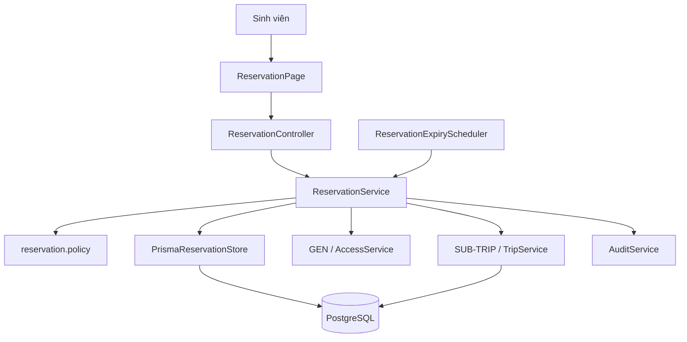

# SUB-RES – Đặt phương tiện dùng chung

## 1. Tổng quan phân hệ

SUB-RES quản lý lượt đặt xe dùng chung của sinh viên trong mạng lưới Smart E-Mobility Hub (SEMH): tạo lượt giữ, hủy lượt đặt, tra cứu lượt đang hiệu lực và xử lý các lượt đã quá hạn. Mục tiêu là sinh viên có thể giữ một xe đủ điều kiện trong 10 phút, đồng thời không có hai lượt giữ hiệu lực cho cùng một sinh viên hoặc một xe.

Phân hệ giải quyết nhu cầu `SN-STU-02`, các user story `US-RES-01`, `US-RES-02` và tuân thủ `BR-RES-01` đến `BR-RES-04`. SUB-RES quản lý lượt đặt, còn việc nhận, sử dụng và trả xe thuộc SUB-TRIP.

## 2. Phạm vi và tác nhân

### 2.1. Tác nhân

| Use case | Tác nhân chính | Tác nhân hỗ trợ |
| --- | --- | --- |
| `UC-RES-01` – Đặt phương tiện dùng chung | Sinh viên (`ACT-STU`) | Không có; sử dụng dữ liệu trạng thái đã được chấp nhận |
| `UC-RES-02` – Hủy lượt đặt phương tiện | Sinh viên (`ACT-STU`) | Không có |

### 2.2. Phạm vi nghiệp vụ

SUB-RES chịu trách nhiệm quản lý lượt đặt phương tiện dùng chung (`VehicleReservation`). Phân hệ tiếp nhận yêu cầu, kiểm tra điều kiện, xác nhận giữ xe, hỗ trợ tra cứu, hủy và xử lý lượt hết hạn. Khi xe được bàn giao hợp lệ, SUB-RES chuyển lượt đặt sang `FULFILLED` theo hợp đồng với SUB-TRIP.

Việc quản lý tài khoản, trực tiếp cập nhật trạng thái xe, xác minh bàn giao và quản lý chuyến đi không thuộc phạm vi SUB-RES. Những công việc này do GEN và TRIP đảm nhiệm; SUB-RES phối hợp qua các hợp đồng công khai.

## 3. Các chức năng chính

| Mã yêu cầu | Use case / chức năng | Mô tả |
| --- | --- | --- |
| `FR-RES-01` | `UC-RES-01` – Đặt phương tiện dùng chung | Xác nhận lượt đặt hợp lệ, chuyển xe sang `RESERVED` và thiết lập hạn nhận sau 10 phút. |
| `FR-RES-02` | `UC-RES-02` – Hủy lượt đặt phương tiện | Sinh viên hủy lượt `PENDING`/`CONFIRMED` của mình; chuyển sang `CANCELLED` và giải phóng xe nếu đủ điều kiện. |
| `NIFR-RES-01` | Giải phóng lượt đặt phương tiện hết hạn | Chuyển lượt `CONFIRMED` chưa nhận xe sang `EXPIRED` khi đến hạn và giải phóng xe nếu đủ điều kiện. |

### 3.1. UC-RES-01 – Đặt phương tiện dùng chung

Sinh viên mở **Khám phá Hub**, chọn Hub và xe dùng chung muốn đặt. 

Quy trình xử lý:

1. Sinh viên chọn xe, xem mã xe, Hub, mức pin và thời gian giữ dự kiến; có thể chọn **Chọn xe khác**.
2. Sinh viên nhấn **Xác nhận đặt xe**. Hệ thống kiểm tra phiên, giới hạn lượt đặt của sinh viên và điều kiện của xe.
3. Nếu xe `AVAILABLE`, pin từ 30% trở lên, xe và Hub đều `ACTIVE`, đồng thời chưa bị giữ bởi người khác, hệ thống xác nhận lượt đặt `CONFIRMED` và giữ xe `RESERVED`.
4. Màn hình **Lượt đặt xe** hiển thị mã lượt đặt, xe, Hub, thời điểm hết hạn và đồng hồ đếm ngược 10 phút.
5. Sinh viên có thể chọn **Nhận xe** để sang `UC-TRIP-01`, hoặc **Hủy lượt đặt** để sang `UC-RES-02`.

Nếu sinh viên đã có lượt giữ hiệu lực, hệ thống hiển thị lượt hiện có. Nếu xe không còn phù hợp hoặc đã được người khác đặt, yêu cầu bị từ chối và sinh viên có thể chọn xe/Hub khác. Yêu cầu không được xác nhận khi dữ liệu trạng thái không đủ tin cậy hoặc không thể cập nhật nhất quán. Nếu quá 10 phút mà sinh viên chưa nhận xe, lượt đặt được xử lý hết hạn theo `NIFR-RES-01`.

### 3.2. UC-RES-02 – Hủy lượt đặt

Sinh viên mở **Lượt đặt xe**, chọn **Hủy lượt đặt** và xác nhận trong hộp thoại.

Quy trình xử lý:

1. Hệ thống kiểm tra phiên đăng nhập, quyền sở hữu và trạng thái lượt đặt.
2. Nếu lượt còn có thể hủy, hệ thống chuyển sang `CANCELLED` và gỡ giữ xe; xe chỉ trở lại `AVAILABLE` khi đủ điều kiện phục vụ.
3. Giao diện hiển thị trạng thái sau khi hủy và cho phép sinh viên quay lại chọn xe khác.

Lượt đã `EXPIRED` hoặc `CANCELLED` được hiển thị theo trạng thái hiện tại. Lượt `FULFILLED` không thể hủy vì xe đã được bàn giao; lượt vừa quá hạn được xử lý thành `EXPIRED` thay vì `CANCELLED`.

### 3.3. NIFR-RES-01 – Xử lý hết hạn

Nếu sinh viên chưa nhận xe trước `expiresAt`, lượt `CONFIRMED` được chuyển sang `EXPIRED`. `ReservationExpiryScheduler` quét mỗi 30 giây và gọi `ReservationService.expireDueReservations()`; service chỉ cập nhật lượt thực sự đến hạn. Việc nhận xe vẫn phải kiểm tra `expiresAt`, không phụ thuộc thời điểm scheduler chạy.

Khi hết hạn, hệ thống gỡ giữ xe và chỉ đưa xe về `AVAILABLE` nếu đủ điều kiện. Giao diện có thể hiển thị lượt hết hạn khi tải lại dữ liệu; cơ chế thông báo chủ động cho sinh viên theo báo cáo cần được kiểm chứng thêm.

## 4. Kiến trúc phân hệ

SUB-RES là module nghiệp vụ trong backend modular monolith của SEMH. Frontend sử dụng React/TypeScript; dữ liệu lưu bằng PostgreSQL thông qua Prisma. Các kiểu dữ liệu dùng chung nằm trong `packages/contracts`.

`ReservationController` tiếp nhận API; `ReservationService` xử lý nghiệp vụ; các hàm trong `reservation.policy.ts` kiểm tra điều kiện đặt và tính hạn giữ; `PrismaReservationStore` truy xuất dữ liệu; scheduler xử lý hết hạn. TRIP cung cấp thao tác giữ và giải phóng phương tiện.

### 4.1. Mô hình dữ liệu

| Đối tượng | Dữ liệu và trách nhiệm chính |
| --- | --- |
| `VehicleReservation` | Lưu sinh viên, xe, Hub, trạng thái, `requestId`, thời điểm xác nhận/hết hạn/kết thúc và `version`. |
| `SharedVehicle` (TRIP) | Lưu trạng thái xe và `reservationHoldId` để xác định lượt đang giữ xe. |
| `Account` (GEN), `MobilityHub` (HUB) | Cung cấp sinh viên sở hữu lượt đặt và Hub nhận xe. |

Theo [Prisma schema](../apps/api/prisma/schema.prisma), `VehicleReservation` có ràng buộc duy nhất theo cặp `studentId`–`requestId`; xe có trường `reservationHoldId` để liên kết lượt giữ hiện tại.

### 4.2. Trạng thái lượt đặt

| Trạng thái | Ý nghĩa |
| --- | --- |
| `PENDING` | Yêu cầu đang chờ theo mô hình trạng thái. |
| `CONFIRMED` | Đã giữ xe, còn hạn nhận xe. |
| `FULFILLED` | Đã bàn giao xe thành công; chuyến đi do TRIP quản lý. |
| `CANCELLED` | Sinh viên đã hủy lượt giữ. |
| `EXPIRED` | Hết hạn nhận xe khi chưa bàn giao. |
| `REJECTED` | Yêu cầu bị từ chối theo mô hình trạng thái. |

Prisma khai báo đủ sáu trạng thái. Tuy nhiên, luồng đặt xe hiện tại tạo trực tiếp `CONFIRMED` khi thành công; các yêu cầu không hợp lệ được trả lỗi, chưa tạo bản ghi `PENDING` hoặc `REJECTED`.

## 5. Cấu trúc source code

| File / thư mục | Trách nhiệm |
| --- | --- |
| [`res.module.ts`](../apps/api/src/modules/res/res.module.ts) | Khai báo module SUB-RES. |
| [`presentation/reservation.controller.ts`](../apps/api/src/modules/res/presentation/reservation.controller.ts) | API đặt, hủy và tra cứu lượt đặt. |
| [`application/reservation.service.ts`](../apps/api/src/modules/res/application/reservation.service.ts) | Xử lý nghiệp vụ, điều phối TRIP và ghi audit. |
| [`domain/reservation.policy.ts`](../apps/api/src/modules/res/domain/reservation.policy.ts) | Kiểm tra điều kiện đặt và tính hạn giữ. |
| [`infrastructure/prisma-reservation.store.ts`](../apps/api/src/modules/res/infrastructure/prisma-reservation.store.ts) | Lưu, đọc và cập nhật lượt đặt qua Prisma. |
| [`infrastructure/reservation-expiry.scheduler.ts`](../apps/api/src/modules/res/infrastructure/reservation-expiry.scheduler.ts) | Quét lượt hết hạn mỗi 30 giây. |
| [`ReservationPage.tsx`](../apps/web/src/features/res/ReservationPage.tsx) | Giao diện đặt, theo dõi, hủy và điều hướng nhận xe. |
| [`reservation-api.ts`](../apps/web/src/features/res/reservation-api.ts) | Gửi yêu cầu đến API RES. |
| [`schema.prisma`](../apps/api/prisma/schema.prisma) | Định nghĩa model và enum lưu trữ. |

## 6. API endpoints

Các đường dẫn bên dưới tính từ API base `/api`, theo `ReservationController` trên nhánh `main`. Các endpoint yêu cầu phiên Sinh viên (`STU`).

| Method | Endpoint | Chức năng |
| --- | --- | --- |
| `POST` | `/reservations` | Đặt xe bằng `requestId`, `vehicleId`, `hubId`. |
| `GET` | `/reservations/active` | Xem lượt giữ còn hiệu lực của mình. |
| `GET` | `/reservations/:reservationId` | Xem một lượt đặt của mình. |
| `POST` | `/reservations/:reservationId/cancel` | Hủy lượt đặt. |
| `GET` | `/reservations/requests/:requestId` | Tra lại kết quả yêu cầu đặt xe đã gửi. |

`requestId` giúp tránh tạo lượt trùng khi người dùng gửi lại cùng yêu cầu. Giao diện gửi CSRF token cho lệnh thay đổi dữ liệu. Backend từ chối yêu cầu không hợp lệ, thiếu quyền hoặc xung đột nghiệp vụ bằng mã lỗi HTTP phù hợp.

## 7. Quy tắc nghiệp vụ và xử lý cạnh tranh

| Mã quy tắc | Nội dung |
| --- | --- |
| `BR-RES-01` | Mỗi sinh viên có tối đa một lượt `PENDING` hoặc `CONFIRMED` tại một thời điểm. |
| `BR-RES-02` | Mỗi xe có tối đa một lượt `PENDING` hoặc `CONFIRMED`; không cho hai người giữ cùng xe. |
| `BR-RES-03` | Lượt `CONFIRMED` giữ xe 10 phút; nếu chưa nhận xe khi đến hạn thì chuyển `EXPIRED`. |
| `BR-RES-04` | Chỉ được đặt xe `AVAILABLE`, pin ít nhất 30%, xe và Hub đều `ACTIVE`. |

Để tránh đặt trùng, service kiểm tra lượt giữ hiện có và phối hợp với TRIP để giữ xe trong cùng transaction `Serializable`. Nếu nhiều người đặt cùng xe, chỉ một yêu cầu được xác nhận; yêu cầu còn lại nhận lỗi xung đột. Các xung đột giao dịch có thể được thử lại tối đa hai lần theo cơ chế chung.

Khi hủy hoặc hết hạn, hệ thống chỉ gỡ đúng lượt đang giữ xe; không tự đưa xe lỗi hoặc còn ràng buộc khác về `AVAILABLE`. `version` được tăng khi đổi trạng thái.

## 8. Tích hợp với các phân hệ khác

| Thành phần | Quan hệ với SUB-RES |
| --- | --- |
| GEN | Kiểm tra phiên đăng nhập, vai trò và quyền truy cập. |
| SUB-HUB | Cung cấp giao diện tra cứu Hub, danh sách xe và bối cảnh Hub để đặt xe. |
| SUB-TRIP | Quản lý xe, giữ/giải phóng xe và xác minh bàn giao để bắt đầu chuyến đi. |
| Audit dùng chung | Ghi lịch sử tạo, hủy và hết hạn lượt đặt. |

Khi sinh viên chọn **Nhận xe**, giao diện chuyển sang quy trình `UC-TRIP-01`. TRIP chỉ hoàn tất bàn giao sau khi có xác nhận hợp lệ từ nguồn trạng thái/IoT; lúc đó RES chuyển lượt sang `FULFILLED`, xe sang `IN_USE` và TRIP tạo chuyến đi.

## 9. Kịch bản kiểm thử

Các kịch bản dưới đây dựa trên Bảng 99 và Bảng 104 của báo cáo, bổ sung trường hợp kiểm tra điều kiện đặt xe. Đây là kết quả mong đợi, không phải biên bản xác nhận test đã chạy thành công.

| Test case | Điều kiện và thao tác | Kết quả mong đợi |
| --- | --- | --- |
| `TC-RES-01` | Sinh viên chưa có lượt giữ đặt xe `Available`, pin 30% tại Hub đang hoạt động; thử đặt thêm xe khác. | Tạo một lượt `CONFIRMED`, xe chuyển `RESERVED`, hạn nhận sau 10 phút; không cho sinh viên giữ hai xe. |
| `TC-RES-02` | Sinh viên có lượt `CONFIRMED` còn hạn chọn **Hủy lượt đặt**; thử khi xe đã `OUT_OF_SERVICE` hoặc lượt đã `FULFILLED`. | Lượt hợp lệ chuyển `CANCELLED`, gỡ giữ đúng xe; không đưa xe lỗi về `AVAILABLE` hoặc hủy lượt đã nhận xe. |
| `TC-COM-01` (phần RES) | Sinh viên tra cứu lượt đặt của người khác; người không có vai trò Sinh viên thử đặt xe. | Backend từ chối truy cập trái quyền, không tiết lộ lượt đặt hoặc ghi thay đổi. |
| `TC-COM-02` | Thử nhận xe trước và đúng thời điểm `expiresAt`; chạy xử lý hết hạn lặp lại, kể cả khi xe đang lỗi. | Đúng hạn không còn được nhận xe; lượt chuyển `EXPIRED`, gỡ giữ an toàn và không mở lại xe `OUT_OF_SERVICE`. |
| `TC-COM-03` | Hai sinh viên đồng thời đặt cùng một xe còn khả dụng. | Chỉ một lượt được xác nhận; yêu cầu còn lại bị từ chối, không giữ trùng xe. |
| `TC-COM-05` (phần RES–TRIP) | Thử nhận xe khi lượt còn hạn, đúng xe/Hub; sau đó thử thiếu bằng chứng bàn giao hoặc sai xe/Hub. | Chỉ bàn giao hợp lệ mới chuyển lượt sang `FULFILLED`, xe sang `IN_USE` và tạo một chuyến đi. |
| `TC-COM-09` (phần RES) | Gửi lại cùng `requestId`, đổi nội dung nhưng giữ ID; giả lập lỗi ghi audit trong lúc đặt xe. | Không tạo lượt trùng; ID trùng khác nội dung bị từ chối; lỗi ghi dữ liệu phải hoàn tác cả lượt đặt và trạng thái giữ xe. |
| Bổ sung – Điều kiện đặt xe | Thử đặt xe pin 29% hoặc tại Hub `INACTIVE`. | Yêu cầu bị từ chối, không tạo lượt giữ hoặc chuyển xe sang `RESERVED`. |

## 10. Hướng dẫn demo

Truy cập [website SEMH](https://semh.brainstorm-challenge.id.vn/) hoặc chạy local theo [README dự án](../README.md). Nên dùng tài khoản và dữ liệu demo được nhóm cho phép.

1. Đăng nhập tài khoản **Sinh viên**, mở **Khám phá Hub** và chọn một xe đủ điều kiện.
2. Tại màn hình đặt xe, xem thông tin xe rồi nhấn **Xác nhận đặt xe**.
3. Trong **Lượt đặt xe**, kiểm tra trạng thái **Đã xác nhận**, Hub nhận xe và đồng hồ đếm ngược 10 phút.
4. Thử **Hủy lượt đặt**, xác nhận hủy và xem kết quả. Với lượt khác, có thể theo dõi trạng thái khi quá 10 phút.
5. Đặt lại một xe hợp lệ, chọn **Nhận xe** để chuyển sang **Chuyến đi**; thao tác bàn giao tiếp theo thuộc TRIP.

Các thử nghiệm cạnh tranh hoặc giả lập lỗi database nên chạy trên môi trường local/test, không làm trên server dùng chung của nhóm.

## 11. Ghi chú đối chiếu thiết kế và triển khai

SUB-RES đã có mã nguồn cho đặt xe, tra cứu, hủy, xử lý hết hạn và phối hợp bàn giao với TRIP. Một số chi tiết khác biệt với mô hình thiết kế cần lưu ý:

- Vòng đời lượt đặt: Sơ đồ trạng thái mô tả `PENDING` và `REJECTED`. Trong phần hiện thực, [`PrismaReservationStore.createConfirmed()`](../apps/api/src/modules/res/infrastructure/prisma-reservation.store.ts) tạo trực tiếp lượt `CONFIRMED` khi đủ điều kiện; yêu cầu không hợp lệ bị từ chối tại tầng ứng dụng, không lưu bản ghi `REJECTED`.
- Tổ chức xử lý và dữ liệu: Thiết kế mô tả `ReservationPolicy` và các phương thức của entity `VehicleReservation`. Phần hiện thực phân chia trách nhiệm giữa [`reservation.policy.ts`](../apps/api/src/modules/res/domain/reservation.policy.ts), [`ReservationService`](../apps/api/src/modules/res/application/reservation.service.ts) và [`PrismaReservationStore`](../apps/api/src/modules/res/infrastructure/prisma-reservation.store.ts). Model trong [`schema.prisma`](../apps/api/prisma/schema.prisma) không có `requestedAt` và `rejectReason` như thiết kế.
- Tra cứu kết quả thao tác: Thiết kế quy định `getChangeResult()` trả `ChangeReceipt`. Phần hiện thực tra cứu lượt đặt theo `studentId` và `requestId` rồi trả `ReservationView` qua [`ReservationService.getChangeResult()`](../apps/api/src/modules/res/application/reservation.service.ts). API hủy tại [`ReservationController`](../apps/api/src/modules/res/presentation/reservation.controller.ts) chưa nhận `requestId` như hợp đồng `ChangeContext` trong thiết kế.
- Kiểm soát cập nhật: Thiết kế yêu cầu kiểm tra `version` của lượt đặt. [`PrismaReservationStore.changeStatus()`](../apps/api/src/modules/res/infrastructure/prisma-reservation.store.ts) đối chiếu trạng thái dự kiến và tăng `version`, nhưng không dùng giá trị `version` cũ trong điều kiện cập nhật. Các lệnh thay đổi vẫn được thực hiện trong transaction `Serializable`.

Mức độ đáp ứng các yêu cầu chất lượng và kết quả kiểm thử thực tế cần được xác nhận bằng các lần chạy test/CI; tài liệu này không thay thế báo cáo kết quả kiểm thử.